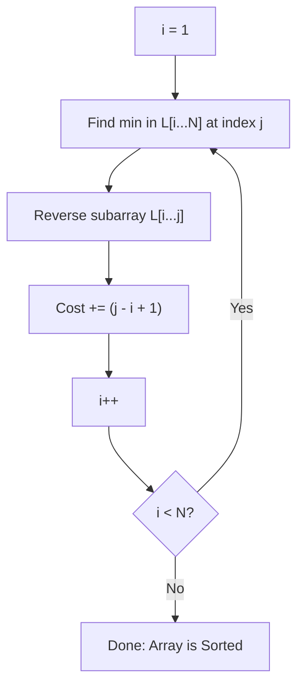
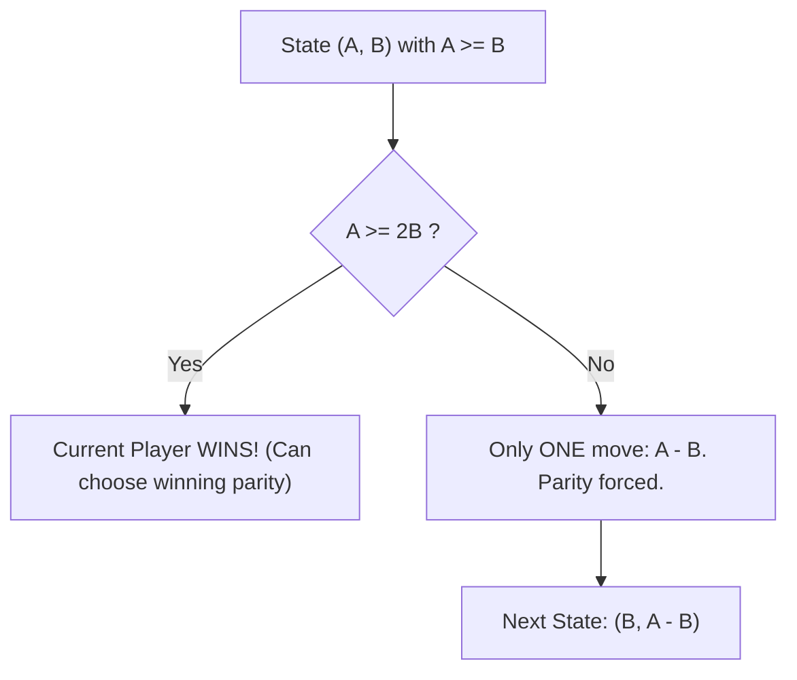

# Week 01 — Simulation, Invariants, Search & Number Theory

> **Official NPTEL Lectures**:
> - Lecture 00 (`vyIZjfUriXI`): Welcome & Course Setup — Platforms & Exam Format
> - Lecture 01 (`SF4G_V-hmPE`, `OrteztaDPao`): Reversort — Simulation, Cost Analysis, Best & Worst Cases
> - Lecture 02 (`sAdDznNwn24`): Engineering Reversort — Inverse Problems & Greedy Backward Construction
> - Lecture 03 (`1EAIR0l9JLk`): Number Game — Impartial Games, Euclidean Reductions & The Golden Ratio
> - Lecture 04 (`21qLdl97uZA`): Will It Stop? — Program Termination, Loop Invariants & Bitwise Powers of 2

---

## 1. The Core Mental Model: Simulation & Invariants

In competitive programming and exam settings, many problems present an **algorithmic process** running on an input. You are asked either:
1. **Direct Simulation**: Trace the execution and compute an aggregate metric (time, cost, operations).
2. **Inverse Construction**: Given the desired outcome and budget, reconstruct a valid starting input.
3. **Loop Invariants & Termination**: Prove whether a process terminates or cycles forever.

The fundamental tool is the **Loop Invariant**: a mathematical condition that remains true before and after each iteration of the loop.

---

## 2. Topic 1: Reversort (Google Code Jam 2021)

### Problem Statement & Process
You are given an array $L$ of $N$ distinct integers. The algorithm works as follows:
```text
For i = 1 to N - 1:
    j = index of the minimum element in L[i ... N]
    Reverse the subarray L[i ... j]
    Cost of step i = (j - i + 1)
Total Cost = sum of costs over all i from 1 to N - 1
```



### Invariant & Extremal Analysis (Crucial for NPTEL MCQs)
1. **Loop Invariant**: At the start of iteration $i$, the prefix $L[1 \dots i-1]$ is sorted and contains the smallest $i-1$ elements in their correct final positions.
2. **Minimum Possible Cost (Best Case)**:
   - When the array is already sorted: at each step $i$, the minimum is already at $j = i$.
   - Cost at step $i = (i - i + 1) = 1$.
   - Total Cost:
     $$\text{Cost}_{\min} = \sum_{i=1}^{N-1} 1 = N - 1$$
3. **Maximum Possible Cost (Worst Case)**:
   - At each step $i$, the minimum element is located at the very end $j = N$.
   - Cost at step $i = (N - i + 1)$.
   - Total Cost:
     $$\text{Cost}_{\max} = \sum_{i=1}^{N-1} (N - i + 1) = N + (N-1) + \dots + 2 = \frac{N(N+1)}{2} - 1$$

---

## 3. Topic 2: Engineering Reversort (Inverse Construction)

### Problem
Given array length $N$ and a target cost $C$, construct a permutation of $\{1, 2, \dots, N\}$ that costs exactly $C$ when sorted by Reversort, or determine that it is `IMPOSSIBLE`.

### Feasibility Condition
A valid permutation exists if and only if:
$$N - 1 \le C \le \frac{N(N+1)}{2} - 1$$

### Socratic Derivation: Greedy Backward Construction
Instead of guessing the initial array forward, **work backwards from the sorted state**:
1. At the end, the array is sorted: $[1, 2, 3, \dots, N]$.
2. In iteration $i$, the cost $c_i = (j - i + 1)$ can be any integer from $1$ to $N - i + 1$.
3. We need $\sum_{i=1}^{N-1} c_i = C$.
4. **Greedy Allocation**: For $i = 1$ to $N-1$:
   - The remaining $N - 1 - i$ steps must each take at least $1$ unit of cost.
   - Therefore, the maximum cost step $i$ can take is $\min(N - i + 1, \; C_{\text{remaining}} - (N - 1 - i))$.
   - Let $c_i$ be this allocated cost.
   - Subtract $c_i$ from $C_{\text{remaining}}$.
5. Once costs $c_1, c_2, \dots, c_{N-1}$ are chosen:
   - Start with $A = [1, 2, \dots, N]$.
   - Iterate backwards from $i = N-1$ down to $1$:
     - Reverse the subarray of length $c_i$ starting at index $i$: from index $i$ to $i + c_i - 1$.
   - The resulting array is the exact initial permutation!

### Production C++ Implementation
```cpp
#include <iostream>
#include <vector>
#include <numeric>
#include <algorithm>

using namespace std;

// Engineering Reversort: Construct permutation of size N with cost C
void solveEngineeringReversort(int N, int C) {
    int minCost = N - 1;
    int maxCost = N * (N + 1) / 2 - 1;

    if (C < minCost || C > maxCost) {
        cout << "IMPOSSIBLE\n";
        return;
    }

    // Step 1: Allocate costs greedily for each of the (N - 1) steps
    vector<int> stepCost(N);
    int remainingC = C;
    for (int i = 1; i <= N - 1; ++i) {
        int stepsAfter = N - 1 - i;
        // Step i can take between 1 and (N - i + 1)
        int maxAllowed = N - i + 1;
        int take = min(maxAllowed, remainingC - stepsAfter);
        stepCost[i] = take;
        remainingC -= take;
    }

    // Step 2: Start from sorted array and reverse backwards
    vector<int> A(N + 1);
    iota(A.begin(), A.end(), 0); // A = [0, 1, 2, ..., N]

    for (int i = N - 1; i >= 1; --i) {
        int len = stepCost[i];
        int l = i;
        int r = i + len - 1;
        reverse(A.begin() + l, A.begin() + r + 1);
    }

    // Output 1-indexed permutation
    for (int i = 1; i <= N; ++i) {
        cout << A[i] << (i == N ? "" : " ");
    }
    cout << "\n";
}
```

---

## 4. Topic 3: Number Game (Euclid's Game & Impartial Games)

### Problem Statement
Two players take turns with two positive integers $(A, B)$ where $A \ge B$.
A move consists of subtracting any positive multiple $k \cdot B$ from $A$ such that the result remains positive ($A - k \cdot B > 0$).
The player who cannot make a move (or who leaves $0$, depending on convention; in GCJ: the player who creates 0 wins) wins.



### The Socratic Insight: The "Choice" Lemma
- If $A < 2B$:
  The current player has **only one valid move**: subtract $1 \cdot B$. The game transitions strictly to $(B, A - B)$. Neither player has any choice; the game proceeds like standard subtraction.
- If $A \ge 2B$:
  The current player has **at least two choices**:
  - Choice 1: Subtract $k \cdot B$ to leave $A \bmod B$.
  - Choice 2: Subtract $(k - 1) \cdot B$ to leave $B + (A \bmod B)$.
  Because one of these transitions leads to a winning position and the other to a losing position, **the player who first encounters $A \ge 2B$ can always force a win!**

### Golden Ratio Connection ($\phi \approx 1.618$)
In the continuous/threshold limit, the boundary condition between an advantageous position and forced steps mirrors the continued fraction expansion of the Euclidean algorithm:
$$\phi = \frac{1 + \sqrt{5}}{2} \approx 1.6180339887...$$
If $A > \phi \cdot B$, the first player can always win.

### C++ Game Resolution
```cpp
#include <iostream>
using namespace std;

// Returns true if the first player to move from (A, B) wins
bool canWin(long long A, long long B) {
    if (A < B) swap(A, B);
    if (B == 0) return false;
    if (A % B == 0) return true; // Can immediately reduce to 0

    // If A >= 2 * B, current player can dictate winning branch
    if (A >= 2 * B) return true;

    // Otherwise, forced move to (B, A - B), turn passes to next player
    return !canWin(B, A - B);
}
```

---

## 5. Topic 4: Will It Stop? (Collatz Variant & Powers of Two)

### Problem
Given a program:
```cpp
while (n > 1) {
    if (n % 2 == 0) n = n / 2;
    else n = 3 * n + 3;
}
```
Does this program ever terminate for a given positive integer $n$?

### Mathematical Proof of Termination Invariant
1. Notice that $3n + 3 = 3(n + 1)$.
2. If $n$ is odd, $n+1$ is even, so $3(n+1)$ is divisible by 6, but after dividing out factors of 2, it retains an odd factor multiplied by 3.
3. If $n = 2^k$ (a pure power of 2):
   - $n$ is always even, so it repeatedly divides by 2 until $n = 1$, and **terminates**.
4. If $n$ has any odd prime factor $p > 1$:
   - Trace small examples:
     - $n = 3 \to 3(3)+3 = 12 \to 6 \to 3$ (infinite cycle: $3 \to 12 \to 6 \to 3$).
     - Any number with an odd factor eventually falls into cycles or diverges.
5. **Conclusion**: The loop terminates **if and only if $n$ is a power of 2**.

### Bitwise Invariant for Powers of 2
To check whether $n$ is a power of 2 in $O(1)$:
```cpp
bool isPowerOfTwo(long long n) {
    return (n > 0) && ((n & (n - 1)) == 0);
}
```
- Why it works: A power of 2 has exactly one binary bit set (`1000...0`).
- $n - 1$ flips that bit to 0 and all trailing zeros to 1 (`0111...1`).
- Bitwise AND between them is strictly `0`.

---

## 6. NPTEL Exam Practice: Hand-Tracing & MCQ Drills

### Exam Problem 1 (NAT): Hand-Tracing Reversort Cost
**Question**: Compute the exact total cost of Reversort on the input array $A = [7, 6, 5, 4, 3, 2, 1]$.
- **Step-by-step Trace**:
  - $N = 7$.
  - Step 1: $i = 1$. Min is 1 at index 7. Reverse $A[1 \dots 7]$. Array becomes $[1, 2, 3, 4, 5, 6, 7]$. Cost $= 7 - 1 + 1 = \mathbf{7}$.
  - Step 2: $i = 2$. Min is 2 at index 2. Reverse $A[2 \dots 2]$. Cost $= 2 - 2 + 1 = \mathbf{1}$.
  - Step 3: $i = 3$. Min is 3 at index 3. Cost $= \mathbf{1}$.
  - Step 4: $i = 4$. Min is 4 at index 4. Cost $= \mathbf{1}$.
  - Step 5: $i = 5$. Min is 5 at index 5. Cost $= \mathbf{1}$.
  - Step 6: $i = 6$. Min is 6 at index 6. Cost $= \mathbf{1}$.
- **Total Cost**: $7 + 1 + 1 + 1 + 1 + 1 = \mathbf{12}$.

### Exam Problem 2 (MSQ): Feasibility of Engineering Reversort
**Question**: For which of the following $(N, C)$ pairs can a valid permutation be engineered?
- (A) $N = 10, C = 8$
- (B) $N = 10, C = 54$
- (C) $N = 5, C = 15$
- (D) $N = 4, C = 6$
- **Analysis**:
  - Bound formula: $N - 1 \le C \le \frac{N(N+1)}{2} - 1$.
  - For $N = 10$: $9 \le C \le \frac{55} - 1 = 54$.
    - (A) $C = 8 < 9$ $\implies$ Impossible.
    - (B) $C = 54 \le 54$ $\implies$ **Valid**.
  - For $N = 5$: $4 \le C \le \frac{30}{2} - 1 = 14$.
    - (C) $C = 15 > 14$ $\implies$ Impossible.
  - For $N = 4$: $3 \le C \le \frac{20}{2} - 1 = 9$.
    - (D) $C = 6 \in [3, 9]$ $\implies$ **Valid**.
- **Correct Options**: **(B) and (D)**.

---

## 7. Active Retrieval Checkpoint (No-AI Test)

1. *What is the maximum cost of Reversort for an array of size $N=6$, and what array configuration achieves it?*
2. *In the Euclidean Number Game, why is a state with $A \ge 2B$ guaranteed to be a winning position?*
3. *Explain bitwise why `(n & (n - 1)) == 0` correctly identifies powers of 2.*
