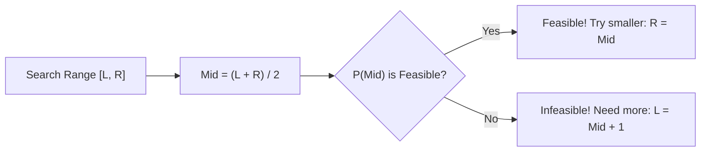
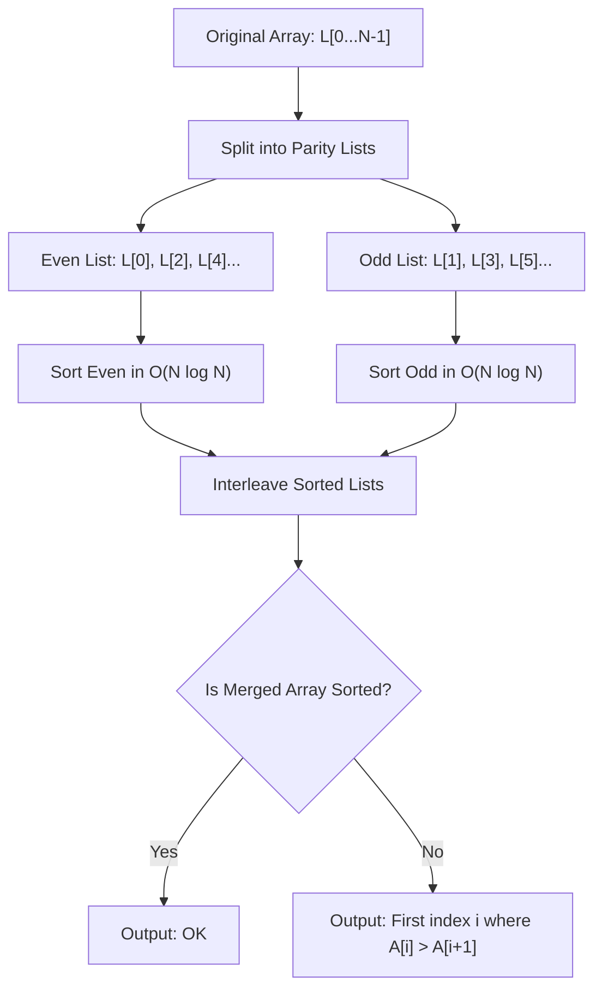
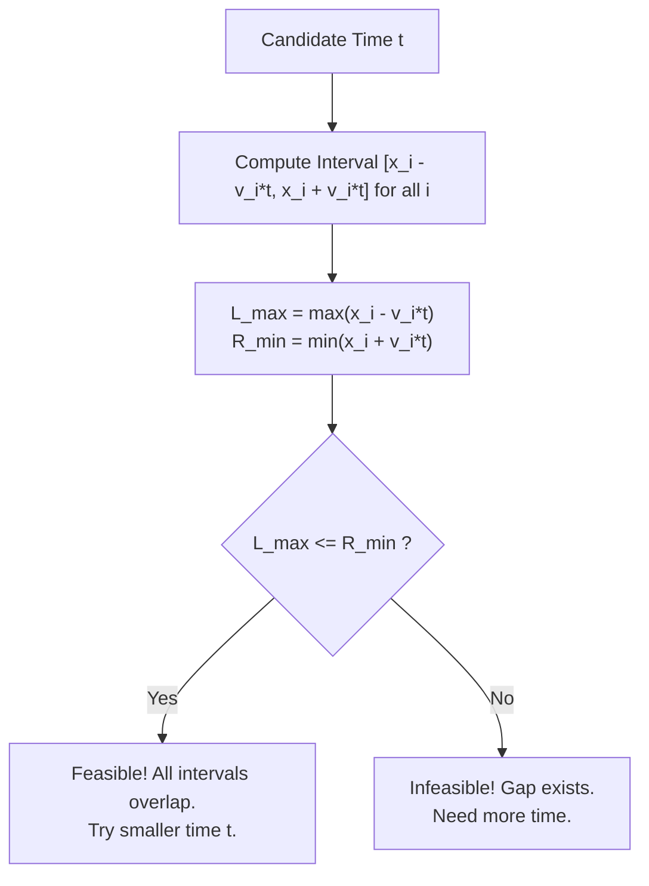

# Week 02 — Sorting Invariants & Binary Search on the Answer

> **Official NPTEL Lectures**:
> - Lecture 05 (`YhzBcZ7haGs`): Trouble Sort (Google Code Jam 2018) — Parity Invariants & Decoupled Subarrays
> - Lecture 06 (`j-R18bZdoRQ`): The Meeting Place Cannot Be Changed (Codeforces 780B) — Continuous Binary Search & Interval Intersections
> - Lecture 07 (`ufuhxF5evCY`): Magic Ship (Codeforces 1117C) — Periodic Prefix Vectors & Manhattan Reachability
> - Lecture 08 (`uJa2ffQYImw`): Simple Skewness — Order Statistics, Mean vs Median & Two-Pointer Maximization

---

## 1. The Core Mental Model: The Monotonicity Filter & Parity Invariants

In competitive programming and NPTEL exam problems, two big ideas dominate this week:
1. **Parity Decomposition (Invariants)**:
   When an operation only acts across fixed step sizes (e.g. index step 2), the entire universe splits into disjoint, independent sub-universes (even indices vs odd indices). Elements can never cross parity boundaries.
2. **Binary Search on the Answer (Predicate Monotonicity)**:
   Instead of directly computing an optimal value $X^*$, define a decision predicate:
   $$P(X) = \text{Is it possible to achieve the goal within budget / time } X?$$
   If $P(X)$ is monotonic (e.g. `False, False, ..., True, True, True`), the boundary between `False` and `True` is findable in logarithmic time $\log(\text{Range})$.



---

## 2. Topic 1: Trouble Sort (Google Code Jam 2018)

### Problem & Pseudocode
```text
TroubleSort(L):
    done = false
    while not done:
        done = true
        for i = 0 to len(L) - 3:
            if L[i] > L[i+2]:
                swap(L[i], L[i+2])
                done = false
```
The question asks: does Trouble Sort always sort the list? If not, what is the index of the first mismatch where $L[i] > L[i+1]$?

### The Socratic Insight: Decoupled Parity Subarrays
Look at the indices swapped: $i$ and $i+2$.
- Notice:
  - Even index $0$ swaps only with $2, 4, 6, \dots$
  - Odd index $1$ swaps only with $3, 5, 7, \dots$
- **Inviolable Invariant**: An element starting at an even index will **forever remain at an even index**. An element starting at an odd index will **forever remain at an odd index**.
- What is Trouble Sort actually doing?
  It is running standard Bubble Sort on the **even subarray** $E = [L[0], L[2], L[4], \dots]$ and independently on the **odd subarray** $O = [L[1], L[3], L[5], \dots]$!
- Both subarrays will end up **individually sorted**.
- But when interleaved back together:
  Is $E[0] \le O[0] \le E[1] \le O[1] \le E[2] \dots$?
  **Not necessarily!**



### Production C++ Implementation ($O(N \log N)$ vs $O(N^2)$ TLE)
```cpp
#include <iostream>
#include <vector>
#include <algorithm>

using namespace std;

void solveTroubleSort() {
    int N;
    if (!(cin >> N)) return;

    vector<int> even, odd;
    for (int i = 0; i < N; ++i) {
        int x; cin >> x;
        if (i % 2 == 0) even.push_back(x);
        else odd.push_back(x);
    }

    sort(even.begin(), even.end());
    sort(odd.begin(), odd.end());

    // Reconstruct interleaved sorted array
    vector<int> sortedA(N);
    for (size_t i = 0; i < even.size(); ++i) sortedA[2 * i] = even[i];
    for (size_t i = 0; i < odd.size(); ++i) sortedA[2 * i + 1] = odd[i];

    // Check for first adjacent inversion
    for (int i = 0; i < N - 1; ++i) {
        if (sortedA[i] > sortedA[i + 1]) {
            cout << i << "\n";
            return;
        }
    }
    cout << "OK\n";
}
```

---

## 3. Topic 2: Continuous Binary Search — The Meeting Place Cannot Be Changed

### Problem Statement (Codeforces 780B)
$N$ people are located at coordinates $x_1, x_2, \dots, x_N$ along a 1D road. Person $i$ has maximum running speed $v_i$.
Find the **minimum time $t$** such that all $N$ people can meet at some single common coordinate $X \in \mathbb{R}$.

### The Predicate Monotonicity
- If all people can meet at time $t$, can they also meet at time $t + \Delta$? **Yes** (they simply run slower or wait).
- Therefore, the feasibility function $P(t)$ is strictly monotonic:
  $$P(t) = \text{Can everyone gather at a common point in } t \text{ seconds?}$$

### Socratic Derivation: Interval Intersection
In time $t$, person $i$ starting at $x_i$ with speed $v_i$ can reach any coordinate in the closed interval:
$$I_i(t) = [x_i - v_i \cdot t, \; x_i + v_i \cdot t] = [L_i, R_i]$$
All $N$ people can meet at a single point $X$ if and only if **all $N$ intervals share at least one common point**:
$$\bigcap_{i=1}^N [L_i, R_i] \ne \emptyset \iff \max_{1 \le i \le N} L_i \le \min_{1 \le i \le N} R_i$$



### Production C++ Implementation (100 Iterations Trick)
```cpp
#include <iostream>
#include <vector>
#include <iomanip>
#include <algorithm>

using namespace std;

bool canMeet(double t, const vector<double>& x, const vector<double>& v) {
    double maxL = -1e18;
    double minR = 1e18;
    for (size_t i = 0; i < x.size(); ++i) {
        maxL = max(maxL, x[i] - v[i] * t);
        minR = min(minR, x[i] + v[i] * t);
    }
    return maxL <= minR;
}

int main() {
    ios::sync_with_stdio(false);
    cin.tie(nullptr);

    int n;
    if (!(cin >> n)) return 0;
    vector<double> x(n), v(n);
    for (int i = 0; i < n; ++i) cin >> x[i];
    for (int i = 0; i < n; ++i) cin >> v[i];

    double low = 0.0, high = 1e9;
    // 100 iterations reduces search space by 2^100 (~10^-30), completely avoiding epsilon precision bugs
    for (int iter = 0; iter < 100; ++iter) {
        double mid = low + (high - low) / 2.0;
        if (canMeet(mid, x, v)) high = mid;
        else low = mid;
    }

    cout << fixed << setprecision(12) << high << "\n";
    return 0;
}
```

---

## 4. Topic 3: Magic Ship (Codeforces 1117C)

### Problem Statement
A ship starts at $(x_1, y_1)$ and needs to reach $(x_2, y_2)$.
The weather follows an $n$-day repeating wind cycle encoded as a string of characters from `U, D, L, R`.
On day $d$:
1. The wind blows the ship 1 unit in its cycle direction.
2. In addition, the captain can choose to move 1 unit in any of `U, D, L, R`, or stand still.
Find the **minimum number of days $d$** to reach the destination, or output `-1`.

### Socratic Derivation: Manhattan Reachability
Suppose we test if destination is reachable in $d$ days:
1. In $d$ days, the wind moves the ship automatically to some position $(X_{\text{wind}}(d), Y_{\text{wind}}(d))$.
   Because the wind string repeats every $n$ days:
   $$d = q \cdot n + r$$
   $$\Delta_{\text{total}} = q \cdot (\text{total wind displacement per cycle}) + (\text{prefix displacement of first } r \text{ days})$$
   This is computed in **$O(1)$** using prefix sums!
2. The captain has $d$ independent choices of control. Each move can alter coordinate distance by at most 1 unit in Manhattan metric.
3. Therefore, starting from $(X_{\text{wind}}(d), Y_{\text{wind}}(d))$, the captain can reach $(x_2, y_2)$ if and only if the remaining Manhattan distance is $\le d$:
   $$|x_2 - X_{\text{wind}}(d)| + |y_2 - Y_{\text{wind}}(d)| \le d$$

### Production C++ Implementation
```cpp
#include <iostream>
#include <string>
#include <vector>
#include <cmath>

using namespace std;

struct Point { long long x, y; };

bool check(long long d, Point start, Point target, const string& s, const vector<Point>& pref) {
    int n = s.size();
    long long q = d / n;
    int r = d % n;

    long long windX = start.x + q * pref[n].x + pref[r].x;
    long long windY = start.y + q * pref[n].y + pref[r].y;

    long long dist = abs(target.x - windX) + abs(target.y - windY);
    return dist <= d;
}

int main() {
    ios::sync_with_stdio(false);
    cin.tie(nullptr);

    Point start, target;
    if (!(cin >> start.x >> start.y >> target.x >> target.y)) return 0;
    int n; cin >> n;
    string s; cin >> s;

    vector<Point> pref(n + 1, {0, 0});
    for (int i = 0; i < n; ++i) {
        pref[i + 1] = pref[i];
        if (s[i] == 'U') pref[i + 1].y++;
        else if (s[i] == 'D') pref[i + 1].y--;
        else if (s[i] == 'L') pref[i + 1].x--;
        else if (s[i] == 'R') pref[i + 1].x++;
    }

    long long low = 1, high = 2e14 + 7, ans = -1;
    while (low <= high) {
        long long mid = low + (high - low) / 2;
        if (check(mid, start, target, s, pref)) {
            ans = mid;
            high = mid - 1; // Try fewer days
        } else {
            low = mid + 1;
        }
    }

    cout << ans << "\n";
    return 0;
}
```

---

## 5. NPTEL Exam Practice: Hand-Tracing & MCQ Drills

### Exam Problem 1 (NAT): Trouble Sort Manual Trace
**Question**: Given input array $A = [8, 9, 7, 2, 6, 4]$, what is the first index where Trouble Sort leaves an inversion, or write -1 if it sorts correctly?
- **Step-by-step Trace**:
  - $N = 6$.
  - Even index elements: indices $0, 2, 4 \implies [8, 7, 6]$. Sorted $\implies [6, 7, 8]$.
  - Odd index elements: indices $1, 3, 5 \implies [9, 2, 4]$. Sorted $\implies [2, 4, 9]$.
  - Interleave back into original indices:
    - index 0: 6
    - index 1: 2
    - index 2: 7
    - index 3: 4
    - index 4: 8
    - index 5: 9
  - Resulting array: $[6, 2, 7, 4, 8, 9]$.
  - Check adjacent pairs:
    - $A[0] = 6 > A[1] = 2$!
  - **Answer**: The first inversion occurs at index **0**.

### Exam Problem 2 (MSQ): Binary Search Conditions
**Question**: Which of the following conditions MUST hold for binary search on the answer to be applicable?
- (A) The target value must be an integer.
- (B) The feasibility function $P(x)$ must be monotonic over the search domain.
- (C) The search space must be finite or bounded by known upper and lower limits.
- (D) The feasibility check $P(x)$ must run in $O(1)$ time.
- **Answer**: **(B) and (C)**.
  - *(A) is FALSE: continuous binary search works on reals $\mathbb{R}$.*
  - *(B) is TRUE: without monotonicity, we cannot discard half the search space.*
  - *(C) is TRUE: initial `low` and `high` bounds are required.*
  - *(D) is FALSE: $P(x)$ can run in $O(N)$, $O(N \log N)$, etc.*

---

## 6. Active Retrieval Checkpoint (No-AI Test)

1. *Why does Trouble Sort fail on the array $[5, 6, 8, 4, 3]$? Trace both even and odd lists by hand.*
2. *In "The Meeting Place Cannot Be Changed", why is non-empty interval intersection equivalent to $\max(L_i) \le \min(R_i)$?*
3. *Why do we run a fixed 100 iterations of binary search on floating point values instead of `while (high - low > EPS)`?*
