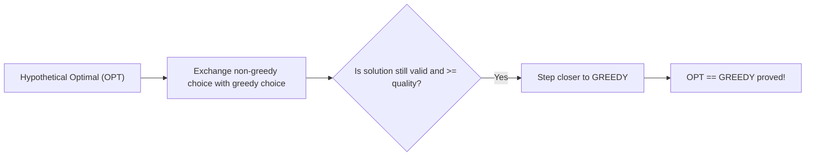
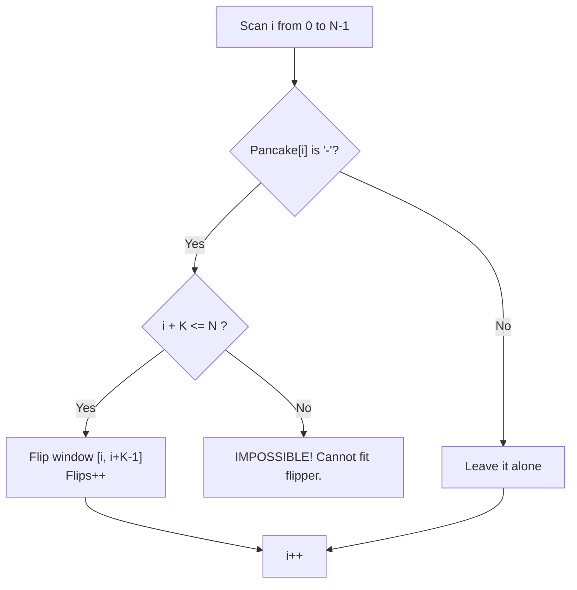
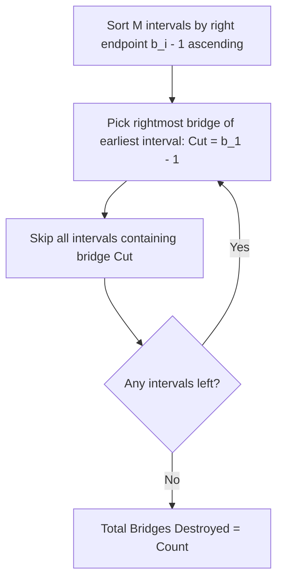
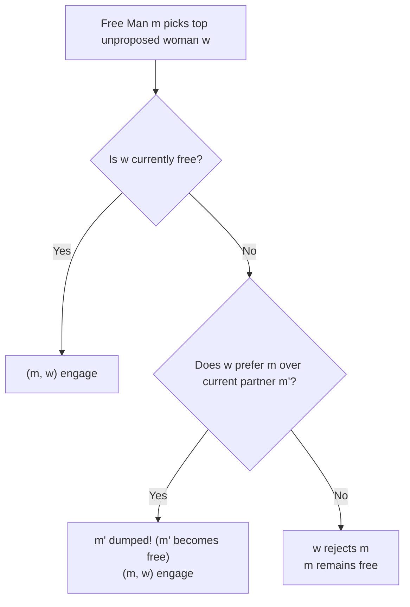

# Week 03 — Greedy Strategies, Exchange Arguments & Stable Matchings

> **Official NPTEL Lectures**:
> - Lecture 09 (`1gL74Fxw8i0`): Oversized Pancake Flipper (Google Code Jam 2017) — Forced Decisions & Window Parity
> - Lecture 10 (`O8uZt4yWxzg`): Islands War (AtCoder) — Interval Piercing & Rightmost Endpoint Scheduling
> - Lecture 11 & 12 (`QGX6yYU8biI`, `4QJE7KE1ikk`): Stable Marriage (Gale-Shapley Algorithm) — Propose-and-Reject Invariants & Optimality Duality
> - Lecture 13, 14, 15 (`RtkfW8bIDfk`, `dC841TyVaCU`, `V2uiNYs_sZ4`): When Greedy Doesn't Work — Counterexamples, Knapsack, Coin Change & Matroid Theory

---

## 1. The Core Mental Model: The Greedy Choice & Exchange Argument

A **Greedy Algorithm** builds a solution step-by-step, making the locally optimal choice at each step without ever backtracking.
To prove a greedy algorithm correct, the gold-standard proof technique is the **Exchange Argument**:
1. Suppose an optimal solution $OPT$ differs from the greedy solution $GREEDY$.
2. Find the *first point of divergence* where $OPT$ made a different choice than $GREEDY$.
3. Show that you can swap (exchange) the choice in $OPT$ with the greedy choice **without decreasing the solution's quality or feasibility**.
4. By repeatedly exchanging differences, you transform $OPT$ into $GREEDY$ with no loss of optimality $\implies GREEDY$ is optimal!



---

## 2. Topic 1: Oversized Pancake Flipper (Google Code Jam 2017)

### Problem
A row of $N$ pancakes, each either happy `+` or blank `-`. A flipper flips a contiguous window of exactly $K$ pancakes. Find the minimum flips to make all happy, or output `IMPOSSIBLE`.

### Socratic Derivation: The Forced Decision Principle
Look at the leftmost pancake at index $i = 0$:
- If it is already `+`, flipping the window $[0, K-1]$ would turn it into `-`. To fix it, you'd have to flip window $[0, K-1]$ again (doing nothing). Thus, **you must NOT flip at index 0**.
- If it is `-`, **you MUST flip the window $[0, K-1]$**. Why? Because every subsequent window flip starts at index $j \ge 1$ and can **never reach index 0 again**! The fate of pancake 0 is determined entirely at step 0!
- By induction, after processing up to index $i-1$, pancake $i$ is only affected by a flip starting at index $i$. Every decision is **forced**.



### Production C++ Implementation ($O(N)$ with Difference Array)
```cpp
#include <iostream>
#include <string>
#include <vector>

using namespace std;

void solvePancakeFlipper() {
    string s;
    int k;
    if (!(cin >> s >> k)) return;

    int n = s.size();
    vector<int> diff(n + 1, 0); // Difference array for range flip parity
    int currentFlips = 0;
    int totalFlips = 0;

    for (int i = 0; i < n; ++i) {
        currentFlips ^= diff[i]; // Running parity of flips affecting index i
        char state = s[i];
        if (currentFlips % 2 == 1) {
            state = (state == '+') ? '-' : '+';
        }

        if (state == '-') {
            if (i + k > n) {
                cout << "IMPOSSIBLE\n";
                return;
            }
            totalFlips++;
            currentFlips ^= 1;
            diff[i + k] ^= 1; // Flip effect ends at index i + k
        }
    }

    cout << totalFlips << "\n";
}
```

---

## 3. Topic 2: Islands War (AtCoder) — Interval Piercing

### Problem Statement
$N$ islands are connected in a line by $N-1$ bridges: $(1-2), (2-3), \dots, (N-1 - N)$.
There are $M$ dispute pairs $(a_i, b_i)$ where islands $a_i$ and $b_i$ must NOT be able to reach each other.
To sever communication between $a_i$ and $b_i$, you must destroy at least one bridge in the range $\{a_i, a_i+1, \dots, b_i-1\}$.
Find the **minimum number of bridges to destroy**.

### Socratic Derivation: The Rightmost Greedy Choice
Each dispute pair $(a_i, b_i)$ defines a required bridge interval $[a_i, b_i - 1]$. We need to select the minimum set of bridges that "pierces" (covers) every interval.
1. Sort all intervals by **right endpoint ascending**: $(b_i - 1)$.
2. For the first interval ending earliest at $R_1 = b_1 - 1$, which bridge should we destroy?
   - Any bridge $x \in [a_1, R_1]$ satisfies interval 1.
   - But choosing the **rightmost bridge $R_1$** extends furthest to the right, maximizing the chance of covering overlapping future intervals!
3. Destroy bridge $R_1$. Discard all subsequent intervals that already contain bridge $R_1$.
4. Repeat for the next uncovered interval.



### Production C++ Implementation
```cpp
#include <iostream>
#include <vector>
#include <algorithm>

using namespace std;

struct Interval {
    int l, r;
    bool operator<(const Interval& other) const {
        return r < other.r; // Sort by right endpoint ascending
    }
};

int main() {
    ios::sync_with_stdio(false);
    cin.tie(nullptr);

    int n, m;
    if (!(cin >> n >> m)) return 0;

    vector<Interval> reqs(m);
    for (int i = 0; i < m; ++i) {
        int a, b; cin >> a >> b;
        reqs[i] = {a, b - 1}; // Bridge indices are 1 to N-1
    }

    sort(reqs.begin(), reqs.end());

    int cuts = 0;
    int lastCut = -1;

    for (const auto& iv : reqs) {
        // If this interval is not yet severed by our last cut bridge
        if (iv.l > lastCut) {
            cuts++;
            lastCut = iv.r; // Cut the rightmost possible bridge
        }
    }

    cout << cuts << "\n";
    return 0;
}
```

---

## 4. Topic 3: Stable Marriage (Gale-Shapley Algorithm)

### Problem & Definition
Given $N$ men and $N$ women, each with a complete preference ranking of all members of the opposite sex.
A matching is **unstable** if there exists a **blocking pair** $(m, w)$ such that:
1. $m$ prefers $w$ over his assigned partner in the matching.
2. $w$ prefers $m$ over her assigned partner in the matching.
A matching is **stable** if no blocking pair exists.

### Gale-Shapley Propose-and-Reject Protocol
```text
Initialize all men and women as free (unengaged).
While there exists a free man m who has not proposed to every woman:
    w = m's highest-ranked woman to whom he has not yet proposed
    If w is free:
        (m, w) become engaged
    Else (w is engaged to m'):
        If w prefers m over m':
            m' becomes free
            (m, w) become engaged
        Else:
            m remains free (w rejects m)
```



### The 4 Foundational Invariants (Exam Favorites!)
1. **Monotonicity of Women's Fortune**: Once a woman gets engaged, she **never becomes free again**, and her partner's rank **strictly improves** over time.
2. **Monotonicity of Men's Fortune**: A man proposes in strictly decreasing order of his preference list. His partner's rank **weakly deteriorates** over time.
3. **Termination**: In each step, a man crosses off one woman from his list. Since there are $N$ men each with $N$ women, the algorithm terminates in **at most $N^2$ proposals**.
4. **Optimality Duality**:
   - The proposing side (Men) achieves **Male-Optimal Stable Matching**: every man gets the best partner he could possibly have in *any* stable matching!
   - The receiving side (Women) gets the **Female-Pessimal Stable Matching**: every woman gets the worst partner she could possibly have in *any* stable matching!

---

## 5. Topic 4: When Greedy Fails & Matroid Foundations

### Classic Failure 1: Coin Change
- For standard currencies (e.g. 1, 2, 5, 10, 20), greedy always finds the minimum number of coins.
- **Counterexample**: Denominations $\{1, 3, 4\}$, Target = $6$.
  - Greedy takes largest: $4 \implies$ remaining $2 \implies 1 + 1$. Total = $4 + 1 + 1 = \mathbf{3}$ coins.
  - Optimal DP solution: $3 + 3 = \mathbf{2}$ coins!

### Classic Failure 2: 0-1 Knapsack
- Knapsack capacity $W = 50$.
  - Item A: weight $10$, value $60$ (ratio $= 6.0$).
  - Item B: weight $20$, value $100$ (ratio $= 5.0$).
  - Item C: weight $30$, value $120$ (ratio $= 4.0$).
- Greedy by value-to-weight ratio takes Item A then Item B: Total weight $30$, Total value $\mathbf{160}$.
- Optimal takes Item B and Item C: Total weight $50$, Total value $\mathbf{220}$!

### When DOES Greedy Work Provably? Matroids!
A structure $(E, \mathcal{I})$ is a **Matroid** if:
1. **Hereditary**: If $A \in \mathcal{I}$ and $B \subseteq A$, then $B \in \mathcal{I}$.
2. **Augmentation / Exchange Property**: If $A, B \in \mathcal{I}$ and $|A| < |B|$, there exists $x \in B \setminus A$ such that $A \cup \{x\} \in \mathcal{I}$.
- **Rado-Edmonds Theorem**: The greedy algorithm finds the maximum weight independent set **if and only if** the system is a Matroid! (e.g., Minimum Spanning Trees / Kruskal's algorithm on Graphic Matroids).

---

## 6. NPTEL Exam Practice: Hand-Tracing & MCQ Drills

### Exam Problem 1 (NAT): Gale-Shapley Proposal Count
**Question**: In a system of $N = 3$ men and $3$ women, each man's top preference is a different woman. How many total proposals are made?
- **Analysis**:
  - Man 1 proposes to his #1 choice (she is free $\implies$ engaged).
  - Man 2 proposes to his #1 choice (she is free $\implies$ engaged).
  - Man 3 proposes to his #1 choice (she is free $\implies$ engaged).
- **Answer**: Exactly **3** proposals.

### Exam Problem 2 (MSQ): Invariants of Gale-Shapley Algorithm
**Question**: Which of the following statements about Gale-Shapley with men proposing are TRUE?
- (A) The algorithm can enter an infinite loop.
- (B) A woman, once engaged, never becomes single again.
- (C) The resulting matching is Pareto optimal for women.
- (D) Every man gets his best valid partner among all stable matchings.
- **Answer**: **(B) and (D)**.
  - *(A) is FALSE: at most $N^2$ proposals.*
  - *(B) is TRUE: women never become unengaged.*
  - *(C) is FALSE: it is woman-pessimal!*
  - *(D) is TRUE: it produces the man-optimal stable matching.*

---

## 7. Active Retrieval Checkpoint (No-AI Test)

1. *In the Islands War problem, why does sorting by right endpoint ascending produce an optimal solution, whereas sorting by left endpoint fails?*
2. *Construct a coin system with 3 coin values where greedy change-making fails for target amount 8.*
3. *State the two axioms of a Matroid and explain why 0-1 Knapsack violates the augmentation axiom.*
