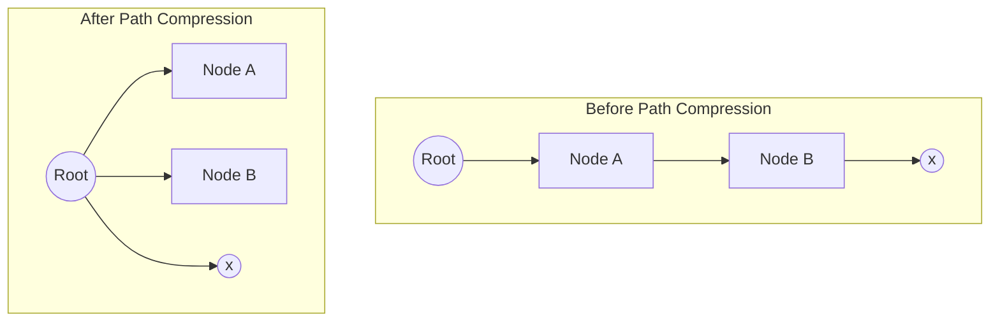
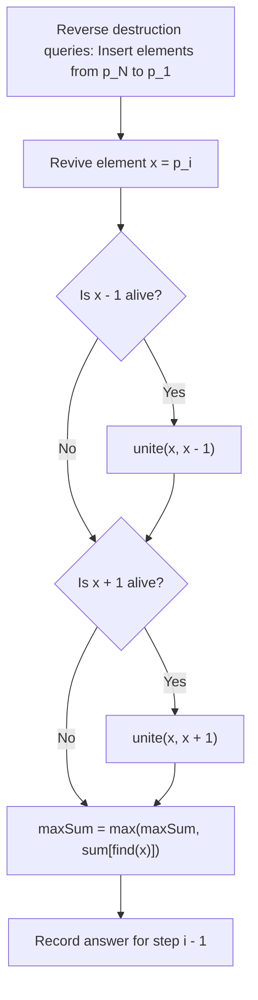
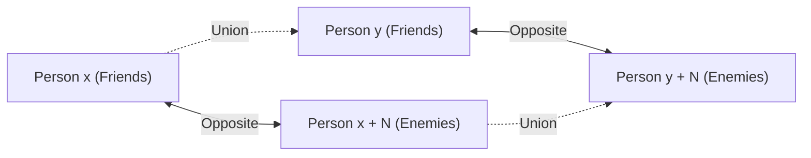

# Week 04 — Disjoint Set Union (DSU) & Offline Time-Reversal

> **Official NPTEL Lectures**:
> - Lecture 16, 17, 18 (`5UTuyOhZGUo`, `FrYLhYFU7oI`, `1vxjvhamD8M`): DSU Foundations — Union by Rank, Path Compression & The Inverse Ackermann Bound
> - Lecture 19 & 20 (`f-66Ku4ogBw`, `g0uY9pwbBW4`): Destroying Arrays (Codeforces 722C) — Offline Query Processing & Time Reversal
> - Lecture 21, 22, 23 (`PvFkkwoUvEc`, `7umEfQd9Bqc`, `HEPK86Ay3iU`): War (UVA 10158) — Bipartite DSU & The 2N Virtual Node Expansion

---

## 1. The Core Mental Model: Equivalence Forests & Path Flattening

The **Disjoint Set Union (DSU)** / Union-Find data structure maintains a collection of disjoint dynamic sets over a universe of $N$ elements.
It supports two primary operations:
1. `find(x)`: Identify the canonical representative (root) of the set containing element $x$.
2. `unite(x, y)`: Merge the set containing $x$ with the set containing $y$.



### The Two Pillars of DSU Optimization

| Optimization | Mechanism | Worst-Case Bound Alone | Combined Bound |
| :--- | :--- | :--- | :--- |
| **Union by Rank / Size** | Always attach the shallower/smaller tree underneath the root of the deeper/larger tree. | $O(\log N)$ | $\mathbf{O(\alpha(N))}$ per op |
| **Path Compression** | During `find(x)`, make every node along the path point directly to the root. | $O(N \log N)$ over $N$ ops | $\mathbf{O(\alpha(N))}$ per op |

### Why Rank Bounding Works (The $2^{\text{rank}}$ Invariant)
- When uniting two trees of rank $r_1$ and $r_2$:
  - If $r_1 \ne r_2$, the rank of the merged tree is $\max(r_1, r_2)$ (no height increase!).
  - If $r_1 = r_2$, the rank increases by $1$ ($r_{\text{new}} = r_1 + 1$).
- **Theorem**: A tree of rank $k$ contains **at least $2^k$ nodes**.
- Since the total number of nodes is $N$:
  $$2^k \le N \implies k \le \lfloor \log_2 N \rfloor$$
  The tree depth with Union by Rank is strictly bounded by $O(\log N)$.

### The Inverse Ackermann Function $\alpha(N)$
When both Union by Rank and Path Compression are combined, the amortized cost per operation drops to $O(\alpha(N))$, where $\alpha(N)$ is the functional inverse of Ackermann's function.
For all practical inputs in competitive programming ($N \le 10^{18}$):
$$\alpha(N) \le 4$$
DSU operations run in virtually **$O(1)$ constant time**.

---

## 2. Production C++ Implementation

```cpp
#include <vector>
#include <numeric>

using namespace std;

struct DSU {
    vector<int> parent;
    vector<int> rank;
    vector<long long> setSize;
    int numSets;

    DSU(int n) : parent(n), rank(n, 0), setSize(n, 1), numSets(n) {
        iota(parent.begin(), parent.end(), 0); // parent[i] = i
    }

    // Find with Path Compression: O(alpha(N))
    int find(int v) {
        if (v == parent[v]) return v;
        return parent[v] = find(parent[v]); // Flatten tree on the way back
    }

    // Union by Rank & Size
    bool unite(int a, int b) {
        a = find(a);
        b = find(b);
        if (a == b) return false; // Already in same set

        // Attach smaller rank tree under larger rank tree
        if (rank[a] < rank[b]) swap(a, b);
        parent[b] = a;
        setSize[a] += setSize[b];
        if (rank[a] == rank[b]) rank[a]++;
        numSets--;
        return true;
    }

    bool sameSet(int a, int b) {
        return find(a) == find(b);
    }
};
```

---

## 3. Topic 2: Destroying Arrays (Codeforces 722C)

### Problem Statement
You are given an array of $N$ integers $a_1, a_2, \dots, a_N$.
You are given a permutation $p_1, p_2, \dots, p_N$ indicating the exact order in which elements are deleted.
After each element $p_i$ is destroyed, you must report the **maximum sum of any contiguous segment of remaining elements**.

### Socratic Derivation: The Time-Reversal Trick
- **The Forward Dilemma**:
  When elements are destroyed, segments break into smaller fragments. Standard DSU **cannot split sets** efficiently.
- **The Reverse Miracle**:
  Run time backwards from step $N$ down to 1!
  1. Start with an empty array of $N$ dead slots.
  2. In reverse order, "revive" (insert) element $p_i$.
  3. Look at its immediate neighbors $p_i - 1$ and $p_i + 1$:
     - If neighbor $p_i - 1$ is already alive, merge their sets using `unite(p_i, p_i - 1)`.
     - If neighbor $p_i + 1$ is already alive, merge their sets using `unite(p_i, p_i + 1)`.
  4. Track the component sum in the DSU root:
     $$\text{sum}[\text{root}_a] += \text{sum}[\text{root}_b]$$
  5. The current maximum segment sum is $\max(\text{previous\_max}, \; \text{sum}[\text{find}(p_i)])$.
  6. Store the answer, and output in reverse!



### Production C++ Implementation
```cpp
#include <iostream>
#include <vector>
#include <algorithm>

using namespace std;

int main() {
    ios::sync_with_stdio(false);
    cin.tie(nullptr);

    int n;
    if (!(cin >> n)) return 0;

    vector<long long> a(n + 1);
    for (int i = 1; i <= n; ++i) cin >> a[i];

    vector<int> p(n + 1);
    for (int i = 1; i <= n; ++i) cin >> p[i];

    vector<int> parent(n + 2);
    vector<long long> segSum(n + 2, 0);
    vector<bool> alive(n + 2, false);

    for (int i = 1; i <= n; ++i) parent[i] = i;

    auto findRoot = [&](auto& self, int u) -> int {
        return parent[u] = (parent[u] == u ? u : self(self, parent[u]));
    };

    vector<long long> answers(n + 1);
    long long currentMax = 0;

    // Process from step N down to 1
    for (int i = n; i >= 1; --i) {
        answers[i] = currentMax; // Max before reviving p[i]

        int u = p[i];
        alive[u] = true;
        segSum[u] = a[u];

        // Merge with left neighbor if alive
        if (u > 1 && alive[u - 1]) {
            int rootLeft = findRoot(findRoot, u - 1);
            parent[rootLeft] = u;
            segSum[u] += segSum[rootLeft];
        }

        // Merge with right neighbor if alive
        if (u < n && alive[u + 1]) {
            int rootRight = findRoot(findRoot, u + 1);
            parent[rootRight] = u;
            segSum[u] += segSum[rootRight];
        }

        currentMax = max(currentMax, segSum[u]);
    }

    // Output forward answers
    for (int i = 1; i <= n; ++i) {
        cout << answers[i] << "\n";
    }
    return 0;
}
```

---

## 4. Topic 3: War (UVA 10158) — The 2N Virtual Expansion

### Problem Statement
Given $N$ people. We receive relationship assertions:
- `setFriends(x, y)`: $x$ and $y$ are friends.
- `setEnemies(x, y)`: $x$ and $y$ are enemies.
- Rules:
  1. Friendship is transitive: Friends of friends are friends.
  2. Enmity is symmetric and reflective: Enemies of enemies are friends!
  3. A person cannot be both a friend and an enemy of the same individual.
If an assertion contradicts established facts, output `-1`.

### Socratic Derivation: The 2N Node Expansion
How do we model two opposed relationship polarities in DSU?
For each person $x \in [0, N-1]$, create **two virtual nodes**:
1. Node $x$: representing the **Friendship Class of $x$**.
2. Node $x + N$: representing the **Enemy Class of $x$**.



### The Inviolable Transition Logic
1. **Contradiction Check**:
   - $x$ and $y$ are friends $\iff \text{find}(x) == \text{find}(y)$.
   - $x$ and $y$ are enemies $\iff \text{find}(x) == \text{find}(y + N)$.
2. **`setFriends(x, y)`**:
   - If $\text{find}(x) == \text{find}(y + N) \implies$ **Contradiction! Return -1**.
   - Otherwise: `unite(x, y)` AND `unite(x + N, y + N)` (my enemies become your enemies).
3. **`setEnemies(x, y)`**:
   - If $\text{find}(x) == \text{find}(y) \implies$ **Contradiction! Return -1**.
   - Otherwise: `unite(x, y + N)` AND `unite(x + N, y)` (enemy of $x$ is friend of $y$).

---

## 5. NPTEL Exam Practice: Hand-Tracing & MCQ Drills

### Exam Problem 1 (NAT): Maximum Tree Height with Union by Rank
**Question**: You perform a sequence of unions on $N = 16$ elements using only **Union by Rank** (without path compression). What is the theoretical maximum height of the resulting tree?
- **Analysis**:
  - Rank starts at 0. A tree of rank $k$ has at least $2^k$ nodes.
  - $2^k \le 16 \implies 2^4 = 16 \implies k = 4$.
- **Answer**: Maximum height is **4**.

### Exam Problem 2 (MSQ): DSU Time Complexities
**Question**: Which of the following statements regarding DSU complexity are TRUE?
- (A) Path compression alone guarantees $O(\log N)$ worst-case time for a single find.
- (B) Union by rank alone guarantees $O(\log N)$ worst-case time for a single find.
- (C) The combination of Union by Rank and Path Compression yields $O(\alpha(N))$ amortized time per operation.
- (D) DSU can be directly used to dynamically split sets in $O(\log N)$ time.
- **Answer**: **(B) and (C)**.
  - *(A) is FALSE: path compression alone can still suffer from $O(N)$ single-operation worst case before paths are flattened.*
  - *(B) is TRUE: height is strictly bounded by $\log_2 N$.*
  - *(C) is TRUE: the classic Tarjan / Hopcroft result.*
  - *(D) is FALSE: standard DSU cannot split sets without complete reconstruction.*

---

## 6. Active Retrieval Checkpoint (No-AI Test)

1. *In Destroying Arrays, why does running the queries in forward time fail with standard DSU?*
2. *In the War problem, what union operations are performed when `setEnemies(x, y)` is executed?*
3. *Prove why a tree of rank $k$ created using Union by Rank must have at least $2^k$ nodes.*
