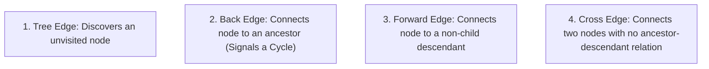
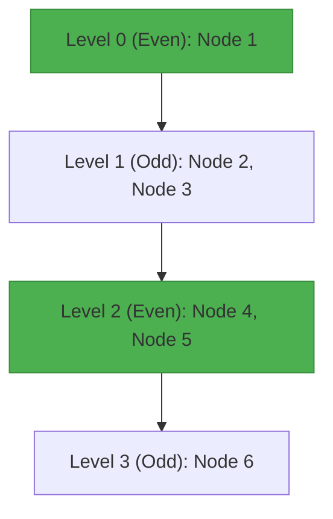
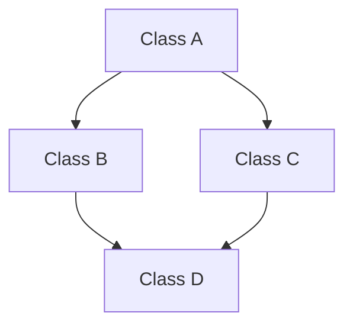

# Week 05 — Graph Traversals, Bipartite Graphs & BFS Level Invariants

> **Official NPTEL Lectures**:
> - Lecture 24 & 25 (`H6wk-CDgLl0`, `G4moHp3IPEQ`): BFS and DFS Foundations — Layering, Time Stamps & Edge Classifications
> - Lecture 26 (`jTqtjvTImDs`): Mahmoud and Ehab and the Bipartiteness (Codeforces 862B) — 2-Coloring & Maximal Bipartite Completion
> - Lecture 27 (`t9Kx1IS8FTA`): Cover It! (Codeforces 1176E) — BFS Depth Parity & The Pigeonhole Dominating Set
> - Lecture 28 (`ZJBLSj3rRb4`): Diamond Inheritance (Google Code Jam) — Multi-Path DAG Reachability & Search Invariants

---

## 1. The Core Mental Model: Traversal Trees & Edge Classification

When traversing an arbitrary graph $G = (V, E)$, BFS and DFS produce a **spanning forest (Traversal Tree)** rooted at the start vertex.
Edges are classified into 4 distinct structural types:



### The Inviolable Edge Classification Theorem (Exam Favorite!)
- **Undirected Graph DFS**:
  Every edge is either a **Tree Edge** or a **Back Edge**.
  **Forward and Cross edges CANNOT exist in an undirected DFS tree!**
  *(Why: If an edge $(u, v)$ existed to another branch, DFS would have explored it immediately before finishing $u$, turning it into a tree edge or ancestor back edge).*
- **Directed Graph DFS**:
  All 4 edge types can exist.
  - Back edges $u \to v \iff \text{ancestor} \iff tin[v] < tin[u] \text{ and } tout[v] > tout[u]$.
  - A directed graph contains a cycle **if and only if DFS encounters a Back Edge**.

---

## 2. Topic 2: Mahmoud and Ehab and the Bipartiteness (Codeforces 862B)

### Problem Statement
You are given a tree with $N$ vertices.
You want to add the maximum possible number of edges to the graph such that:
1. The graph remains **bipartite** (no odd-length cycles).
2. No multiple edges or self-loops are created.
Output the maximum number of new edges you can add.

### Socratic Derivation: Bipartite Maximization
1. **Fact**: Every tree is inherently bipartite! A tree has 0 cycles, so it cannot contain odd cycles.
2. Run 2-coloring (via BFS or DFS) from any node (say node 1):
   - Color 0: nodes at even distance from root. Let size = $n_1$.
   - Color 1: nodes at odd distance from root. Let size = $n_2$.
3. In any bipartite graph with partition sizes $n_1$ and $n_2$:
   - Edges can only exist between a node in Set 1 and a node in Set 2.
   - The theoretical maximum number of edges is a **Complete Bipartite Graph $K_{n_1, n_2}$**, containing:
     $$\text{Max Edges} = n_1 \cdot n_2$$
4. The given tree already contains $N - 1$ edges.
5. Therefore, the maximum number of new edges we can add is:
   $$\text{Answer} = n_1 \cdot n_2 - (N - 1)$$

```mermaid
flowchart LR
    subgraph Color Set 0 (Size n1)
        A["Node 1"]
        B["Node 3"]
        C["Node 5"]
    end
    subgraph Color Set 1 (Size n2)
        D["Node 2"]
        E["Node 4"]
    end
    A <--> D
    B <--> D
    C <--> E
    A -. New Edge .-> E
    B -. New Edge .-> E
```

### Production C++ Implementation
```cpp
#include <iostream>
#include <vector>

using namespace std;

void dfs(int u, int p, int c, const vector<vector<int>>& adj, long long& count0, long long& count1) {
    if (c == 0) count0++;
    else count1++;

    for (int v : adj[u]) {
        if (v != p) {
            dfs(v, u, 1 - c, adj, count0, count1);
        }
    }
}

int main() {
    ios::sync_with_stdio(false);
    cin.tie(nullptr);

    int n;
    if (!(cin >> n)) return 0;

    vector<vector<int>> adj(n + 1);
    for (int i = 0; i < n - 1; ++i) {
        int u, v; cin >> u >> v;
        adj[u].push_back(v);
        adj[v].push_back(u);
    }

    long long count0 = 0, count1 = 0;
    dfs(1, 0, 0, adj, count0, count1);

    long long totalMaxEdges = count0 * count1;
    long long ans = totalMaxEdges - (n - 1);

    cout << ans << "\n";
    return 0;
}
```

---

## 3. Topic 3: Cover It! (Codeforces 1176E) — The BFS Pigeonhole Dominator

### Problem Statement
Given an undirected connected graph with $N$ vertices and $M$ edges.
Select a subset of at most $\lfloor N / 2 \rfloor$ vertices such that every vertex in the graph is either in your subset, or directly connected by an edge to at least one vertex in your subset (a dominating set bounded by $\le N/2$).

### Socratic Derivation: BFS Parity Layering
How can we guarantee a dominating set of size $\le N/2$ in *any* graph?
1. Run a BFS starting from vertex 1.
2. Partition the vertices into two groups based on the parity of their BFS tree distance:
   $$S_{\text{even}} = \{v \in V : \text{dist}(1, v) \text{ is even}\}$$
   $$S_{\text{odd}} = \{v \in V : \text{dist}(1, v) \text{ is odd}\}$$
3. Notice:
   - $S_{\text{even}} \cup S_{\text{odd}} = V$ and $S_{\text{even}} \cap S_{\text{odd}} = \emptyset$.
   - $|S_{\text{even}}| + |S_{\text{odd}}| = N$.
4. By the **Pigeonhole Principle**:
   $$\min(|S_{\text{even}}|, |S_{\text{odd}}|) \le \left\lfloor \frac{N}{2} \right\rfloor$$
   Pick whichever set is smaller!
5. **Why is it guaranteed to dominate all vertices?**
   In a BFS tree, every vertex $v$ at distance $d \ge 1$ has a tree edge connecting it to its parent $p$ at distance $d - 1$.
   Because $d$ and $d - 1$ have **opposite parities**, every vertex in the non-selected set is directly adjacent to its parent in the selected set!



### Production C++ Implementation
```cpp
#include <iostream>
#include <vector>
#include <queue>

using namespace std;

void solveCoverIt() {
    int n, m;
    cin >> n >> m;

    vector<vector<int>> adj(n + 1);
    for (int i = 0; i < m; ++i) {
        int u, v; cin >> u >> v;
        adj[u].push_back(v);
        adj[v].push_back(u);
    }

    vector<int> dist(n + 1, -1);
    queue<int> q;
    q.push(1);
    dist[1] = 0;

    vector<int> evenNodes, oddNodes;

    while (!q.empty()) {
        int u = q.front();
        q.pop();

        if (dist[u] % 2 == 0) evenNodes.push_back(u);
        else oddNodes.push_back(u);

        for (int v : adj[u]) {
            if (dist[v] == -1) {
                dist[v] = dist[u] + 1;
                q.push(v);
            }
        }
    }

    const auto& chosen = (evenNodes.size() <= oddNodes.size()) ? evenNodes : oddNodes;

    cout << chosen.size() << "\n";
    for (size_t i = 0; i < chosen.size(); ++i) {
        cout << chosen[i] << (i + 1 == chosen.size() ? "" : " ");
    }
    cout << "\n";
}
```

---

## 4. Topic 4: Diamond Inheritance (Google Code Jam)

### Problem Statement
Given an object-oriented class inheritance hierarchy of $N$ classes, modeled as a Directed Acyclic Graph (DAG).
Determine if there exists **diamond inheritance**: i.e., whether there exist two classes $A$ and $B$ such that $B$ inherits from $A$ through **two or more distinct paths**.



### Socratic Derivation: Multiple Reachability in DAGs
- Diamond inheritance occurs $\iff$ there exists some node $u$ from which a traversal (BFS/DFS) can reach some node $v$ by **two distinct paths**.
- **Search Invariant**:
  If we start a BFS/DFS from vertex $u$, and during the traversal we attempt to visit a vertex $v$ that has **already been marked visited in this same search**, then we have found two distinct paths from $u$ to $v$!
- **Algorithm**:
  For each vertex $u = 1 \dots N$:
  - Run a BFS starting at $u$.
  - Maintain a fresh `visited[]` array for this search.
  - If any neighbor $v$ of the current node is already `visited[v] == true`, output `Yes` (diamond detected!).
  - If all searches complete with no re-visits, output `No`.
- **Complexity**: $O(N \cdot (V + E))$. For $N \le 1000, M \le 10000$, this runs in $< 0.1$ seconds!

---

## 5. NPTEL Exam Practice: Hand-Tracing & MCQ Drills

### Exam Problem 1 (NAT): Tree Bipartite Completion
**Question**: A tree has $N = 7$ vertices. BFS 2-coloring assigns 4 vertices to Color 0 and 3 vertices to Color 1. What is the maximum number of new edges that can be added while keeping the graph bipartite?
- **Analysis**:
  - Max edges in bipartite graph $= n_1 \cdot n_2 = 4 \times 3 = 12$.
  - Existing tree edges $= N - 1 = 7 - 1 = 6$.
  - New edges allowed $= 12 - 6 = \mathbf{6}$.
- **Answer**: **6**.

### Exam Problem 2 (MSQ): Edge Classifications in DFS
**Question**: Which of the following statements about DFS trees are TRUE?
- (A) In an undirected graph, a DFS tree can contain cross edges.
- (B) In a directed graph, the presence of a back edge is equivalent to the existence of a cycle.
- (C) In a tree with $N$ vertices, the size of the smaller parity set from BFS distance is at most $\lfloor N / 2 \rfloor$.
- (D) Bipartite graphs can contain cycles of length 5.
- **Answer**: **(B) and (C)**.
  - *(A) is FALSE: undirected DFS only has tree and back edges.*
  - *(B) is TRUE: fundamental theorem of DAGs.*
  - *(C) is TRUE: direct consequence of Pigeonhole Principle.*
  - *(D) is FALSE: bipartite graphs cannot contain odd cycles.*

---

## 6. Active Retrieval Checkpoint (No-AI Test)

1. *Prove why cross edges cannot exist in an undirected DFS tree.*
2. *In "Cover It!", why is it guaranteed that picking the smaller parity set covers all vertices in the graph?*
3. *What is the relationship between the number of vertices in a tree and the number of edges?*
