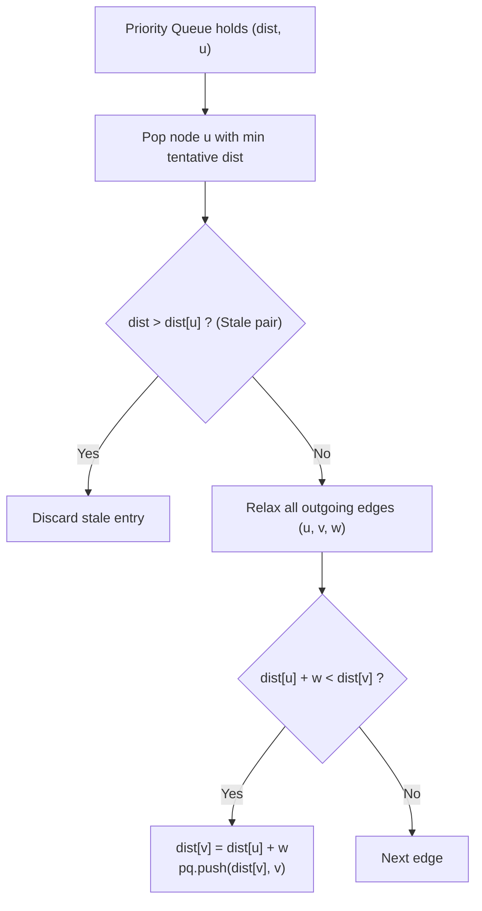
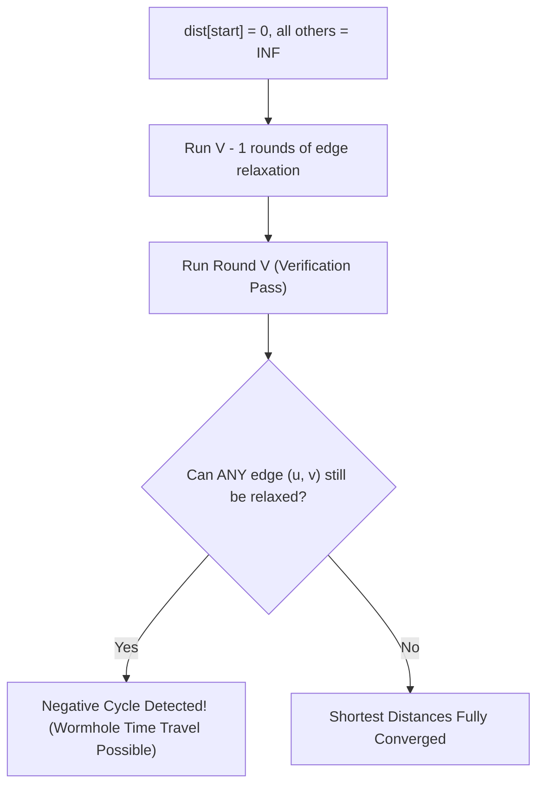

# Week 06 — Shortest Paths: BFS, Dijkstra, Bellman-Ford & Floyd-Warshall

> **Official NPTEL Lectures**:
> - Lecture 29, 30, 31, 32 (`e4gxFrCBoCQ`, `VcqN9oBAR0c`, `i5o95SbONp4`, `4lAmSnfJfek`): SSSP Foundations, Dijkstra's Algorithm & Sending Email (UVA 10986)
> - Lecture 33 & 34 (`kqCDWYsFksU`, `XUoGWZ-qXFY`): SSSP with Negative Cycles, Bellman-Ford & Wormholes (UVA 558)
> - Lecture 35 & 36 (`OgM3SwahPtU`, `r7Y0sgjBY5k`): All-Pairs Shortest Paths (APSP), Floyd-Warshall & Page Hopping (UVA 821)

---

## 1. The Shortest Path Algorithm Spectrum

Choosing the correct shortest path algorithm depends strictly on two factors: **Graph Density / Pairs** and **Edge Weight Characteristics**.

| Algorithm | Scope | Edge Weight Constraint | Time Complexity | Negative Cycle Detection? |
| :--- | :--- | :--- | :--- | :--- |
| **Standard BFS** | Single-Source (SSSP) | Unweighted / Uniform ($w = 1$) | $O(V + E)$ | N/A |
| **0-1 BFS** | Single-Source (SSSP) | Binary weights ($w \in \{0, 1\}$) | $O(V + E)$ | N/A |
| **Dijkstra's Algorithm** | Single-Source (SSSP) | **Non-negative only** ($w \ge 0$) | $O((V + E) \log V)$ | **FAILS on negative edges** |
| **Bellman-Ford** | Single-Source (SSSP) | Arbitrary real weights | $O(V \cdot E)$ | **Yes** (detects negative cycles) |
| **Floyd-Warshall** | All-Pairs (APSP) | Arbitrary real weights | $O(V^3)$ | **Yes** (if `dist[i][i] < 0`) |

---

## 2. Topic 1: Dijkstra's Algorithm & Sending Email (UVA 10986)

### The Core Greedy Invariant
Dijkstra maintains a priority queue of tentative distances.
- **The Invariant**: When node $u$ with minimum tentative distance is popped from the priority queue, **its true shortest path distance is permanently finalized**.
- **Why Dijkstra FAILS on Negative Edges**:
  If edge $(A, B)$ has weight $-10$, a path discovered later through $A$ could decrease the shortest distance to $B$ *after* $B$ was already popped and finalized. Dijkstra never revisits finalized nodes!



### Production C++ Implementation (Dijkstra)
```cpp
#include <iostream>
#include <vector>
#include <queue>

using namespace std;

const long long INF = 1e18;

struct Edge {
    int to;
    long long weight;
};

void dijkstra(int startNode, int n, const vector<vector<Edge>>& adj, vector<long long>& dist) {
    dist.assign(n + 1, INF);
    dist[startNode] = 0;

    // min-heap priority queue storing {distance, vertex}
    priority_queue<pair<long long, int>, vector<pair<long long, int>>, greater<pair<long long, int>>> pq;
    pq.push({0, startNode});

    while (!pq.empty()) {
        auto [d, u] = pq.top();
        pq.pop();

        // Skip stale (lazy) priority queue entries
        if (d > dist[u]) continue;

        for (const auto& edge : adj[u]) {
            int v = edge.to;
            long long w = edge.weight;

            // Relaxation step
            if (dist[u] + w < dist[v]) {
                dist[v] = dist[u] + w;
                pq.push({dist[v], v});
            }
        }
    }
}
```

---

## 3. Topic 2: Bellman-Ford & Wormholes (UVA 558)

### The Simple Path Principle
In any graph with $V$ vertices without negative cycles, a shortest path between two nodes is **simple** (visits no vertex twice), meaning it contains at most **$V - 1$ edges**.

### Socratic Derivation: Bellman-Ford
1. In round 1, we relax all $E$ edges $\implies$ all shortest paths of length $\le 1$ edge are optimal.
2. In round 2, we relax all $E$ edges $\implies$ all shortest paths of length $\le 2$ edges are optimal.
3. In round $V - 1$, all shortest paths of length $\le V - 1$ edges are optimal!
4. **Negative Cycle Detection (The $V$-th Round)**:
   What if on the $V$-th pass, an edge $(u, v)$ can **still be relaxed** (`dist[u] + w < dist[v]`)?
   This means a path with $V$ edges is strictly shorter than a path with $V-1$ edges. By Pigeonhole Principle, a vertex was visited twice $\implies$ **A Negative Weight Cycle exists!**



### Production C++ Implementation (Bellman-Ford)
```cpp
#include <iostream>
#include <vector>

using namespace std;

struct Edge {
    int u, v;
    long long w;
};

const long long INF = 1e18;

bool hasNegativeCycle(int n, const vector<Edge>& edges) {
    vector<long long> dist(n, 0); // Start from all nodes to detect any cycle

    // Relax all edges V - 1 times
    for (int iter = 0; iter < n - 1; ++iter) {
        for (const auto& e : edges) {
            if (dist[e.u] + e.w < dist[e.v]) {
                dist[e.v] = dist[e.u] + e.w;
            }
        }
    }

    // 1 additional pass to check for relaxation
    for (const auto& e : edges) {
        if (dist[e.u] + e.w < dist[e.v]) {
            return true; // Negative cycle detected!
        }
    }
    return false;
}
```

---

## 4. Topic 3: Floyd-Warshall All-Pairs Shortest Path (UVA 821 Page Hopping)

### The Dynamic Programming Formulation
Let $DP[k][i][j]$ be the shortest path from vertex $i$ to vertex $j$ using only intermediate vertices from the prefix set $\{1, 2, \dots, k\}$.
- **Base Case**: $DP[0][i][j] = \text{weight of direct edge } (i, j)$, or $0$ if $i = j$, else $\infty$.
- **Transition**:
  When considering vertex $k$ as an allowed intermediate waypoint:
  $$DP[k][i][j] = \min(\underbrace{DP[k-1][i][j]}_{\text{Path does not use } k}, \quad \underbrace{DP[k-1][i][k] + DP[k-1][k][j]}_{\text{Path goes through } k})$$

```mermaid
flowchart LR
    i["Node i"] -->|DP[k-1][i][k]| k["Intermediate Node k"]
    k -->|DP[k-1][k][j]| j["Node j"]
    i -. "Direct: DP[k-1][i][j]" .-> j
```

> [!CAUTION]
> **The Classic Exam Trap: Outer Loop $k$**:
> The intermediate vertex $k$ **MUST be the outermost loop**!
> If you put $i$ or $j$ in the outer loop, you violate the topological ordering of the DP subproblems, resulting in incorrect shortest paths.

### Production C++ Implementation (Floyd-Warshall)
```cpp
#include <iostream>
#include <vector>
#include <algorithm>

using namespace std;

const long long INF = 1e18;

void floydWarshall(int n, vector<vector<long long>>& dist) {
    // Outer loop MUST be intermediate vertex k
    for (int k = 1; k <= n; ++k) {
        for (int i = 1; i <= n; ++i) {
            for (int j = 1; j <= n; ++j) {
                if (dist[i][k] < INF && dist[k][j] < INF) {
                    dist[i][j] = min(dist[i][j], dist[i][k] + dist[k][j]);
                }
            }
        }
    }
}
```

---

## 5. NPTEL Exam Practice: Hand-Tracing & MCQ Drills

### Exam Problem 1 (NAT): Hand-Tracing Floyd-Warshall Table
**Question**: Given a 3-vertex directed graph:
$1 \to 2$ (weight 4), $2 \to 3$ (weight 1), $1 \to 3$ (weight 8).
What is the value of `dist[1][3]` after the $k = 2$ outer loop iteration of Floyd-Warshall?
- **Analysis**:
  - Initial matrix ($k = 0$): `dist[1][2] = 4`, `dist[2][3] = 1`, `dist[1][3] = 8`.
  - For $k = 1$: no path through node 1 improves any distance.
  - For $k = 2$: considering intermediate node 2:
    $$\text{dist}[1][3] = \min(\text{dist}[1][3], \; \text{dist}[1][2] + \text{dist}[2][3]) = \min(8, \; 4 + 1) = \mathbf{5}$$
- **Answer**: **5**.

### Exam Problem 2 (MSQ): Algorithm Properties
**Question**: Which of the following statements about shortest path algorithms are TRUE?
- (A) Dijkstra's algorithm always finds the correct shortest path on graphs with negative edge weights as long as there are no negative cycles.
- (B) Bellman-Ford runs in $O(V \cdot E)$ time and correctly detects negative cycles reachable from the source.
- (C) In Floyd-Warshall, the existence of any diagonal element with `dist[i][i] < 0` signifies the presence of a negative cycle.
- (D) 0-1 BFS can be implemented using a double-ended queue (`std::deque`) in $O(V + E)$ time.
- **Answer**: **(B), (C), and (D)**.
  - *(A) is FALSE: Dijkstra fails on negative edges regardless of cycles.*
  - *(B) is TRUE: standard Bellman-Ford property.*
  - *(C) is TRUE: a path from $i$ back to $i$ with cost $< 0$ is a negative cycle.*
  - *(D) is TRUE: 0-1 BFS pushes 0-edges to front, 1-edges to back.*

---

## 6. Active Retrieval Checkpoint (No-AI Test)

1. *Why does Dijkstra's algorithm fail on graphs with negative edge weights? Draw a 3-node counterexample.*
2. *Why does Bellman-Ford require exactly $V - 1$ rounds of edge relaxation before testing for negative cycles?*
3. *What happens to the Floyd-Warshall result if the loop over $i$ is placed outside the loop over $k$?*
