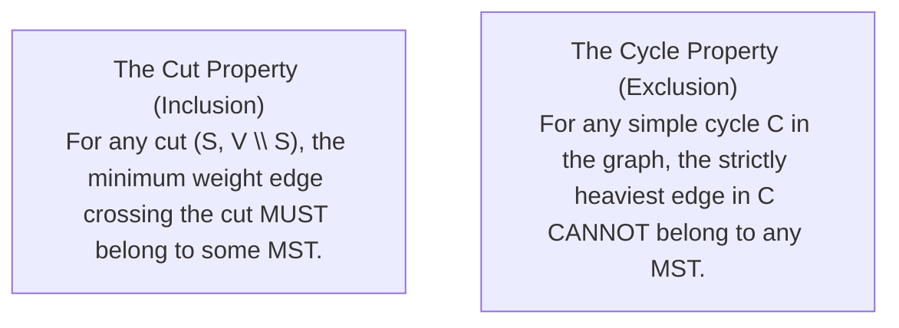
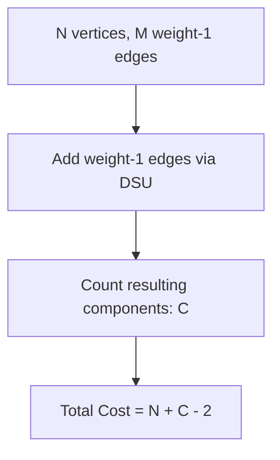
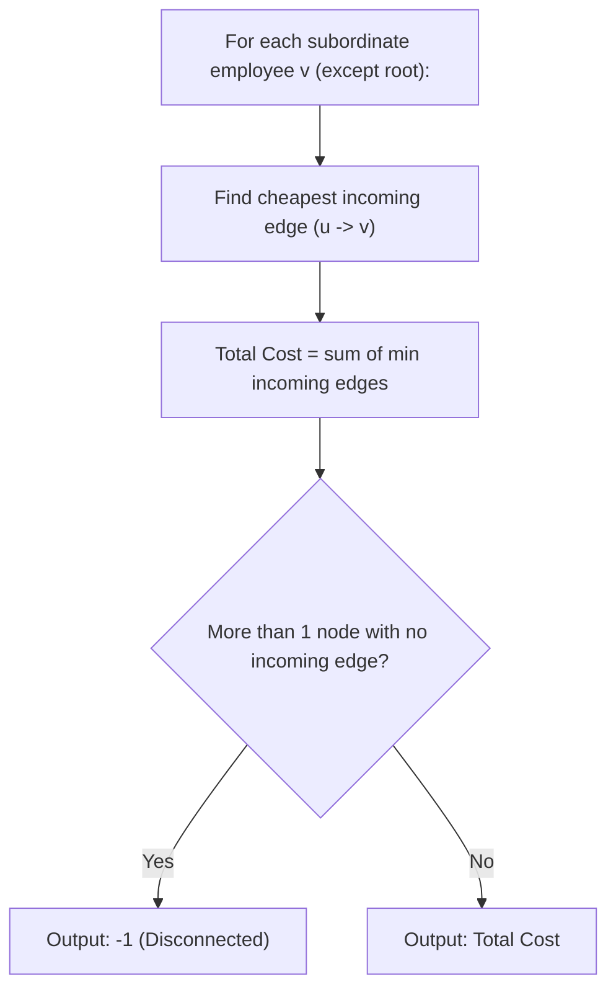

# Week 07 — Minimum Spanning Trees (MST) & Directed Arborescences

> **Official NPTEL Lectures**:
> - Lecture 37, 38, 39 (`CWttO6NF4Is`, `64Sv47zIW0s`, `rg_LMdgGaSo`): MST Foundations — The Cut Property, The Cycle Property, Prim & Kruskal
> - Lecture 40 (`uapfTneyfsU`): Cherries Mesh (Google Kickstart) — Component Reductions & Unit Weight Maximization
> - Lecture 41 (`hXD5AzDTIWg`): Hierarchy (Codeforces 17B) — Directed Minimum Spanning Trees (Arborescences) & In-Degree Independence
> - Lecture 42 (`yvqtNWZoLS8`): Island Hopping (UVA 10147) — Kruskal with Pre-Existing Networks

---

## 1. The Core Mental Model: The Cut & Cycle Properties

A **Spanning Tree** of a connected undirected graph $G = (V, E)$ is an acyclic subgraph containing all $V$ vertices and exactly $V - 1$ edges.
A **Minimum Spanning Tree (MST)** minimizes the total sum of edge weights $\sum_{e \in T} w(e)$.

Every MST algorithm (Kruskal, Prim, Borůvka) relies on two fundamental geometric theorems:



### 1. The Cut Property (Prim's Foundation)
- Partition $V$ into two disjoint sets $S$ and $V \setminus S$.
- Any edge connecting a node in $S$ to a node in $V \setminus S$ crosses the cut.
- **Rule**: The lightest edge crossing this cut is guaranteed to be safe to add to the MST.

### 2. The Cycle Property (Kruskal's Foundation)
- If adding an edge $e$ to your existing edge set forms a cycle $C$:
- The heaviest edge in cycle $C$ will never be needed to maintain connectivity, as lighter alternative paths exist.

---

## 2. Kruskal vs Prim: The Algorithmic Duality

| Feature | Kruskal's Algorithm | Prim's Algorithm |
| :--- | :--- | :--- |
| **Philosophy** | Global greedy: sorts ALL edges in graph | Local greedy: grows a single connected blob |
| **Data Structure** | **Disjoint Set Union (DSU)** | **Priority Queue / Min-Heap** |
| **Time Complexity** | $O(E \log E)$ or $O(E \log V)$ | $O((V + E) \log V)$ |
| **Best Used When** | Sparse graphs ($E \approx V$) or edges already sorted | Dense graphs ($E \approx V^2$) |

---

## 3. Topic 2: Cherries Mesh (Google Kickstart)

### Problem Statement
$N$ vertices. There are $M$ special black edges of weight **1**.
Any other pair of vertices can be connected using a red edge of weight **2**.
Find the **minimum total cost** to connect all $N$ vertices into a single spanning tree.

### Socratic Derivation: Greedy Component Reduction
1. To minimize total cost, we should prioritize using as many weight-1 edges as possible before using any weight-2 edges.
2. Initialize a DSU with $N$ vertices.
3. For each of the $M$ given black edges $(u, v)$:
   - Attempt `unite(u, v)`.
   - If successful, this edge forms part of our MST at cost **1**.
   - If $u$ and $v$ are already connected, skip it (avoid cycle).
4. Suppose after adding all safe weight-1 edges, we have formed $C$ connected components using $K = N - C$ edges.
5. To connect these $C$ disjoint components into a single tree, we require exactly **$C - 1$ additional edges**.
6. Because no more weight-1 edges can bridge these components, these $C - 1$ remaining edges **must be chosen from the weight-2 red edges**.
7. **Closed-Form Formula**:
   $$\text{Total Cost} = K \cdot 1 + (C - 1) \cdot 2 = (N - C) \cdot 1 + 2C - 2 = \mathbf{N + C - 2}$$



### Production C++ Implementation
```cpp
#include <iostream>
#include <vector>
#include <numeric>

using namespace std;

struct DSU {
    vector<int> parent;
    int components;
    DSU(int n) : parent(n + 1), components(n) {
        iota(parent.begin(), parent.end(), 0);
    }
    int find(int u) {
        return parent[u] = (parent[u] == u ? u : find(parent[u]));
    }
    bool unite(int u, int v) {
        u = find(u); v = find(v);
        if (u == v) return false;
        parent[v] = u;
        components--;
        return true;
    }
};

void solveCherriesMesh() {
    int n, m;
    if (!(cin >> n >> m)) return;

    DSU dsu(n);
    for (int i = 0; i < m; ++i) {
        int u, v; cin >> u >> v;
        dsu.unite(u, v);
    }

    int c = dsu.components;
    long long ans = (long long)n + c - 2;
    cout << ans << "\n";
}
```

---

## 4. Topic 3: Hierarchy (Codeforces 17B) — The Directed MST

### Problem Statement
In a corporate hierarchy of $N$ employees, we want to construct a supervisory tree (a **Directed Arborescence**) rooted at one top supervisor.
Each employee $i$ has qualification score $q_i$.
A directed supervisory application $(u \to v)$ with cost $c$ can only be established if $q_u > q_v$.
Find the **minimum total cost** to establish a valid hierarchy where every employee except the root has exactly one direct supervisor, or output `-1`.

### Socratic Derivation: In-Degree Independence
- In any rooted directed tree of $N$ nodes:
  - The root has **in-degree 0**.
  - Every other $N - 1$ vertex has **in-degree exactly 1**!
- Look at employee $v$:
  - $v$ requires exactly one supervisor $u \to v$.
  - The choice of who supervises $v$ **does not constrain the choice of who supervises another employee $w$**!
  - Therefore, for every non-root employee $v$, we simply pick their **cheapest possible incoming edge**:
    $$\text{cost}(v) = \min_{(u, v) \in E} \text{cost}(u, v)$$
- **Condition for Feasibility**:
  - Exactly one employee (the global maximum qualification) can have no supervisor (in-degree 0).
  - If two or more employees have no incoming edges, no valid tree can cover them $\implies \mathbf{-1}$.
  - Otherwise, sum the minimum incoming edge cost for all $N - 1$ subordinate employees!



### Production C++ Implementation
```cpp
#include <iostream>
#include <vector>
#include <algorithm>

using namespace std;

const long long INF = 1e18;

int main() {
    ios::sync_with_stdio(false);
    cin.tie(nullptr);

    int n;
    if (!(cin >> n)) return 0;

    vector<int> q(n + 1);
    for (int i = 1; i <= n; ++i) cin >> q[i];

    int m; cin >> m;
    vector<long long> minInCost(n + 1, INF);

    for (int i = 0; i < m; ++i) {
        int u, v; long long c;
        cin >> u >> v >> c;
        // Edge u -> v: v gets supervised by u
        minInCost[v] = min(minInCost[v], c);
    }

    int zeroInCount = 0;
    long long totalCost = 0;

    for (int i = 1; i <= n; ++i) {
        if (minInCost[i] == INF) {
            zeroInCount++;
        } else {
            totalCost += minInCost[i];
        }
    }

    // A valid tree must have exactly ONE root with 0 incoming edges
    if (zeroInCount == 1) {
        cout << totalCost << "\n";
    } else {
        cout << -1 << "\n";
    }

    return 0;
}
```

---

## 5. Topic 4: Island Hopping (UVA 10147) — Pre-Existing Networks

### Algorithm Blueprint
1. Compute Euclidean distance matrix for all $\binom{N}{2}$ island pairs.
2. Initialize DSU for $N$ nodes.
3. For each of the $M$ already-built bridges, immediately call `unite(u, v)`.
4. If the number of components is already 1, output `"No new bridges are needed"`.
5. Otherwise, sort all remaining island pairs by Euclidean distance ascending.
6. Run standard Kruskal: whenever `unite(u, v)` successfully connects two previously disjoint sets, print the pair $(u, v)$ as a newly constructed bridge!

---

## 6. NPTEL Exam Practice: Hand-Tracing & MCQ Drills

### Exam Problem 1 (NAT): Cherries Mesh Hand-Trace
**Question**: $N = 6$ cherries. You are given $M = 3$ black edges of weight 1: $(1-2), (2-3), (4-5)$. All other possible connections cost 2. What is the minimum cost to form a spanning tree?
- **Analysis**:
  - Connected components after black edges:
    - Component A: $\{1, 2, 3\}$ (using 2 edges of weight 1)
    - Component B: $\{4, 5\}$ (using 1 edge of weight 1)
    - Component C: $\{6\}$ (isolated node)
  - Number of components $C = 3$.
  - Formula: $\text{Total Cost} = N + C - 2 = 6 + 3 - 2 = \mathbf{7}$.
  - Verification: 3 black edges (cost $3 \times 1 = 3$) + 2 red bridges to connect 3 components (cost $2 \times 2 = 4$). Total $= 3 + 4 = \mathbf{7}$.
- **Answer**: **7**.

### Exam Problem 2 (MSQ): MST Properties
**Question**: Which of the following statements about Minimum Spanning Trees are TRUE?
- (A) In a graph with unique edge weights, the MST is unique.
- (B) If the heaviest edge of a graph belongs to a cycle, it can never belong to any MST.
- (C) Prim's algorithm runs faster on dense graphs than Kruskal's algorithm when using an adjacency matrix.
- (D) The shortest path between two nodes in a graph is always a path in the MST.
- **Answer**: **(A), (B), and (C)**.
  - *(A) is TRUE: unique edge weights guarantee a unique MST.*
  - *(B) is TRUE: fundamental Cycle Property.*
  - *(C) is TRUE: dense Prim runs in $O(V^2)$ without heap, beating Kruskal's $O(V^2 \log V)$.*
  - *(D) is FALSE: classic counterexample: triangle with weights 1, 1, 1.5. Direct edge of 1.5 is shortest path, but MST path has length 2.*

---

## 7. Active Retrieval Checkpoint (No-AI Test)

1. *State the Cut Property of MSTs and explain how Prim's algorithm uses it.*
2. *In the Hierarchy problem, why does choosing the minimum incoming edge for each vertex independently guarantee an optimal directed tree without cycles?*
3. *Why is Kruskal's algorithm preferred over Prim's for sparse graphs with $E \approx V$?*
