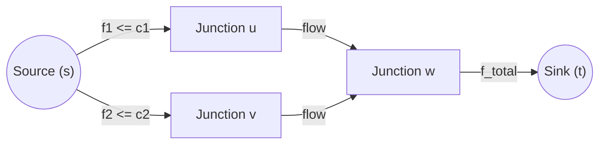
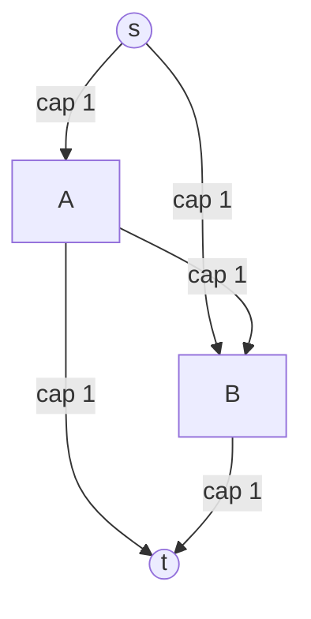
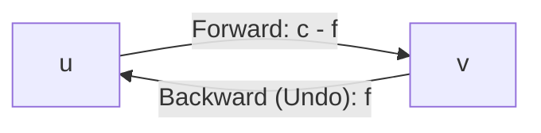
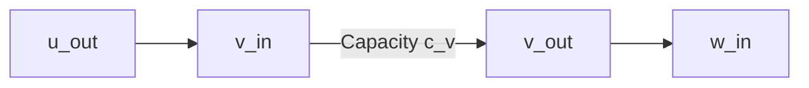
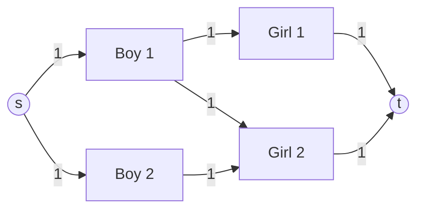
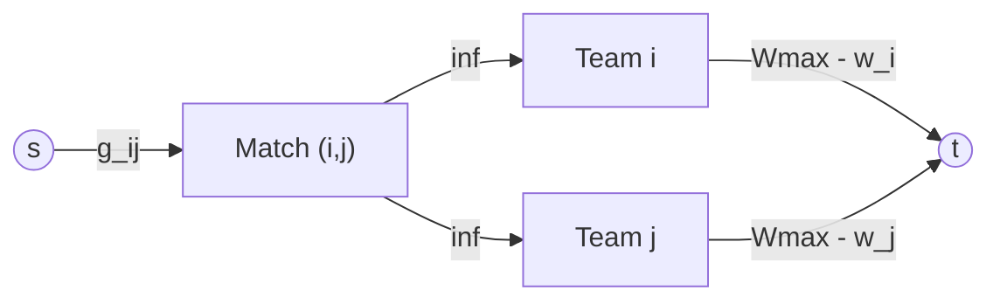

# Week 08 — Network Flow Foundations, Residual Graphs & Reductions

> **Official NPTEL Lectures**: 
> - Lecture 43 (`jABR99y4g80`): Introduction to Network Flow (Part 1) — Flow Networks, Conservation, UVA 820 Internet Bandwidth
> - Lecture 44 (`MRN_qmYrSXI`): Introduction to Network Flow (Part 2) — The Greedy Failure Trap, Residual Networks & The Undo Button
> - Lecture 45 (`Z0XA1dOvNU0`): Introduction to Network Flow (Part 3) — C++ Implementation, Twin Edges, Vertex Capacities
> - Lecture 46 (`fUSDS_uJ-f8`): Maximum Matchings via Max Flow — Codeforces Bersu Ball & Integrality Theorem
> - Lecture 47 (`DkUWF7j10YM`): Sports & IPL Elimination — Game Nodes, Team Nodes & Capacity Caps

---

## 1. The Core Mental Model: Flow Networks & Conservation

### Physical Intuition: The Water Pipe Network
Imagine an underground plumbing network carrying water from a single pumping station (the **Source $s$**) to a treatment facility (the **Sink $t$**).
- Every pipe $e = (u, v)$ has a maximum physical width: its **Capacity $c(u, v) \ge 0$**.
- Water cannot compress or accumulate inside intermediary junction points: whatever volume of water enters node $u$ must immediately leave node $u$.



### The Formal Rules of Flow
A valid flow $f: E \to \mathbb{R}_{\ge 0}$ satisfies two inviolable rules:
1. **Capacity Constraint**: For every edge $(u, v) \in E$:
   $$0 \le f(u, v) \le c(u, v)$$
   You cannot push more water through a pipe than its physical capacity allows.

2. **Flow Conservation**: For every vertex $u \in V \setminus \{s, t\}$:
   $$\sum_{v: (v, u) \in E} f(v, u) = \sum_{w: (u, w) \in E} f(u, w)$$
   $$\text{Total Inflow into } u = \text{Total Outflow from } u$$
   Water cannot pool, leak, or magically generate at intermediate vertices.

3. **Value of Flow $|f|$**:
   The net amount leaving the source (which equals the net amount entering the sink):
   $$|f| = \sum_{v: (s, v) \in E} f(s, v) - \sum_{u: (u, s) \in E} f(u, s)$$

---

## 2. Why Greedy Fails & The Residual Graph ("The Undo Button")

### The Greedy Trap: The Diamond Graph
Consider the classic 4-node diamond network:
- $s \to A$ with capacity $1$
- $s \to B$ with capacity $1$
- $A \to t$ with capacity $1$
- $B \to t$ with capacity $1$
- Cross-pipe $A \to B$ with capacity $1$



- **The Global Optimum**: Send 1 unit through $s \to A \to t$, and 1 unit through $s \to B \to t$. Total Flow = **2**.
- **The Greedy Blunder**: Suppose your path search naively chooses $s \to A \to B \to t$ first. It pushes 1 unit.
  - Edge $(s, A)$ now has flow 1 (full).
  - Edge $(A, B)$ now has flow 1 (full).
  - Edge $(B, t)$ now has flow 1 (full).
  If you simply delete saturated edges, **no path exists from $s$ to $t$**! Greedy gets trapped at Flow = **1**.

### The Solution: The Residual Graph $G_f$
To fix a bad decision, we must allow future paths to **cancel** previously routed flow.
For every edge $(u, v)$ with capacity $c(u, v)$ and current flow $f(u, v)$:
1. **Forward Edge $(u, v)$**: has residual capacity $c_f(u, v) = c(u, v) - f(u, v)$ (how much *more* we can push forward).
2. **Backward Edge $(v, u)$**: has residual capacity $c_f(v, u) = f(u, v)$ (how much flow we can *push backward to cancel*).



### The Miracle of the Backward Edge in Action
After pushing 1 unit through $s \to A \to B \to t$:
- Backward edge $(B, A)$ appears with capacity $1$.
- In the residual graph, a new augmenting path exists: **$s \to B \to A \to t$**!
  1. $s \to B$ pushes 1 unit forward.
  2. $B \to A$ pushes 1 unit along the backward edge. Pushing flow backwards along $(A, B)$ **reduces the net flow on $(A, B)$ from 1 to 0**!
  3. $A \to t$ pushes 1 unit forward.
- **Net Result**: Edge $(A, B)$ now has flow 0. Edge $(A, t)$ has flow 1. Edge $(B, t)$ has flow 1. Total flow = **2**!

> [!IMPORTANT]
> **Key Exam Mental Model**:
> A backward edge is an **Undo (Ctrl+Z)** operation. Pushing flow along a backward edge $v \to u$ redirects the flow that was originally entering $v$ from $u$ to a new destination, freeing up $u$ to send its flow elsewhere.

---

## 3. Max Flow Algorithms Compared

| Algorithm | Augmenting Path Selection | Time Complexity | When to Use in CP |
| :--- | :--- | :--- | :--- |
| **Ford-Fulkerson** | Any DFS path | $O(E \cdot |f|)$ | Small flow values or proving concepts. Fails on irrational capacities. |
| **Edmonds-Karp** | Shortest path by edge count (BFS) | $O(V \cdot E^2)$ | Simple to write, sufficient for $V \le 200, E \le 1000$. |
| **Dinic's Algorithm** | BFS level graph + DFS blocking flow | $O(V^2 E)$ general<br>$O(E \sqrt{V})$ unit networks | **The standard CP workhorse**. Runs well within time limits for $V, E \approx 10^4 - 10^5$. |

---

## 4. Production C++ Implementation (Dinic's Algorithm)

```cpp
#include <iostream>
#include <vector>
#include <queue>
#include <algorithm>

using namespace std;

// Dinic's Algorithm for Maximum Flow
// Time Complexity: O(V^2 * E) general networks, O(E * sqrt(V)) for unit networks / bipartite matching.
struct Dinic {
    struct Edge {
        int to;
        long long cap;
        long long flow;
        int rev; // Index of the reverse edge in G[to]
    };

    int n;
    vector<vector<Edge>> adj;
    vector<int> level; // BFS distance from source (Level Graph)
    vector<int> ptr;   // Pointer to next edge to explore (Current-Arc Optimization)

    Dinic(int n) : n(n), adj(n), level(n), ptr(n) {}

    // Add directed edge u -> v with capacity cap
    void addEdge(int u, int v, long long cap) {
        Edge forward = {v, cap, 0, (int)adj[v].size()};
        Edge backward = {u, 0, 0, (int)adj[u].size()}; // Cap = 0 for directed edges
        adj[u].push_back(forward);
        adj[v].push_back(backward);
    }

    // Step 1: Build Level Graph via BFS
    bool bfs(int s, int t) {
        fill(level.begin(), level.end(), -1);
        level[s] = 0;
        queue<int> q;
        q.push(s);

        while (!q.empty()) {
            int v = q.front();
            q.pop();

            for (const auto& edge : adj[v]) {
                // If capacity remains and neighbor is unvisited
                if (edge.cap - edge.flow > 0 && level[edge.to] == -1) {
                    level[edge.to] = level[v] + 1;
                    q.push(edge.to);
                }
            }
        }
        return level[t] != -1; // Can we reach sink?
    }

    // Step 2: Push Blocking Flow along Level Graph via DFS
    long long dfs(int v, int t, long long pushed) {
        if (pushed == 0 || v == t) return pushed;

        // Current-arc optimization: ptr[v] ensures dead edges are never scanned twice
        for (int& cid = ptr[v]; cid < (int)adj[v].size(); ++cid) {
            auto& edge = adj[v][cid];
            int tr = edge.to;

            // Only advance to the next level in the level graph
            if (level[v] + 1 != level[tr] || edge.cap - edge.flow == 0) continue;

            long long tr_pushed = dfs(tr, t, min(pushed, edge.cap - edge.flow));
            if (tr_pushed == 0) continue;

            // Augment flow on forward and backward edges
            edge.flow += tr_pushed;
            adj[tr][edge.rev].flow -= tr_pushed;
            return tr_pushed;
        }
        return 0;
    }

    long long maxFlow(int s, int t) {
        long long flow = 0;
        const long long INF = 1e18;

        // Phase loop: while target is reachable in residual graph
        while (bfs(s, t)) {
            fill(ptr.begin(), ptr.end(), 0);
            while (long long pushed = dfs(s, t, INF)) {
                flow += pushed;
            }
        }
        return flow;
    }
};
```

---

## 5. Structural Reductions: How to Model Real Problems as Max Flow

### Reduction 1: Node Capacities (Vertex Splitting)
**Problem**: Each vertex $v$ has a maximum throughput capacity $c_v$ (e.g. router bandwidth or junction capacity).
**Transformation**:
Split vertex $v$ into two nodes: $v_{in}$ and $v_{out}$.
1. Direct all incoming edges to $v_{in}$: edge $(u, v)$ becomes $(u_{out}, v_{in})$ with original capacity.
2. Add an internal directed edge from $v_{in}$ to $v_{out}$ with capacity $c_v$.
3. Direct all outgoing edges from $v_{out}$: edge $(v, w)$ becomes $(v_{out}, w_{in})$ with original capacity.



---

### Reduction 2: Bipartite Matching (Codeforces Bersu Ball)
**Problem**: $N$ boys and $M$ girls. Boy $i$ can dance with Girl $j$ if their dancing skill difference $|a_i - b_j| \le 1$. Each boy dances with at most 1 girl. Find the maximum number of pairs.

**Network Construction**:
1. Create a super Source $s$ and super Sink $t$.
2. For each Boy $i$, add directed edge $s \to \text{Boy}_i$ with capacity **1**.
3. For each Girl $j$, add directed edge $\text{Girl}_j \to t$ with capacity **1**.
4. If Boy $i$ and Girl $j$ can pair up, add directed edge $\text{Boy}_i \to \text{Girl}_j$ with capacity **1**.
5. Max Pairs = `maxFlow(s, t)`.



> [!NOTE]
> **Integrality Theorem**: If all capacities in a flow network are integers, there exists a maximum flow where the flow on every edge is an integer. Because all capacities are 1, every edge has flow either 0 or 1. A flow of 1 on $\text{Boy}_i \to \text{Girl}_j$ represents a chosen pair!

---

### Reduction 3: Tournament & Sports Elimination (IPL Elimination)
**Problem**: We want to determine if team $X$ (e.g. RCB) can mathematically finish first (or tie for first).
- Team $i$ currently has $w_i$ wins.
- Team $X$ has $r_X$ remaining matches. Maximum possible wins for $X = W_{\max} = w_X + r_X$.
- Between team $i$ and team $j$, there are still $g_{ij}$ matches left to play.

**Step 1: Trivial Elimination Check**
If any team $i$ already has strictly more wins than $W_{\max}$ ($w_i > W_{\max}$), team $X$ is immediately eliminated!

**Step 2: Flow Network Construction**
Assume team $X$ wins ALL its remaining games. Can the remaining games between other teams be played out without any other team exceeding $W_{\max}$ wins?
1. **Source $s$ to Match Nodes**:
   For every pair of other teams $(i, j)$ with $g_{ij} > 0$, create a match vertex $M_{ij}$.
   Add edge $s \to M_{ij}$ with capacity $g_{ij}$ (total games to distribute).
2. **Match Nodes to Team Nodes**:
   Each game $M_{ij}$ produces 1 win for either team $i$ or team $j$.
   Add edges $M_{ij} \to T_i$ (cap $\infty$) and $M_{ij} \to T_j$ (cap $\infty$).
3. **Team Nodes to Sink $t$**:
   Team $i$ cannot exceed $W_{\max}$ total wins.
   Add edge $T_i \to t$ with capacity $W_{\max} - w_i$ (remaining wins budget).



**Verdict**:
- Calculate $\text{TotalRemaining} = \sum_{i < j, i, j \ne X} g_{ij}$.
- If $\text{maxFlow}(s, t) == \text{TotalRemaining}$, all remaining matches can be resolved without any team surpassing team $X \implies$ **Team $X$ is NOT eliminated**.
- If $\text{maxFlow}(s, t) < \text{TotalRemaining}$, some matches cannot be allocated without someone exceeding $W_{\max} \implies$ **Team $X$ is mathematically ELIMINATED**.

---

## 6. NPTEL Exam Practice: Hand-Tracing & MCQ Drills

### Exam Problem 1 (NAT): Manual Residual Capacity Calculation
**Question**: Consider an edge $(u, v)$ with original capacity $c(u, v) = 15$. During execution, flow $f(u, v) = 9$ is sent. What are the forward residual capacity $c_f(u, v)$ and backward residual capacity $c_f(v, u)$?
- **Solution**:
  - Forward: $c_f(u, v) = c(u, v) - f(u, v) = 15 - 9 = \mathbf{6}$.
  - Backward: $c_f(v, u) = f(u, v) = \mathbf{9}$.

### Exam Problem 2 (MSQ): Properties of Residual Networks
**Question**: Which of the following statements about residual networks $G_f$ are TRUE?
- (A) The residual capacity of an edge can be negative.
- (B) If an edge $(u, v)$ has $f(u, v) = c(u, v)$, the forward edge $(u, v)$ does not exist in $G_f$.
- (C) Augmenting flow along a backward edge in $G_f$ decreases the flow in the original network.
- (D) Edmonds-Karp terminates in at most $O(V \cdot E)$ augmentations.
- **Answer**: **(B), (C), and (D)**.
  - *(A) is FALSE: residual capacities are strictly non-negative.*
  - *(B) is TRUE: $c_f(u, v) = c - c = 0$, so edge has 0 capacity (effectively omitted).*
  - *(C) is TRUE: pushing flow backward cancels existing flow.*
  - *(D) is TRUE: each augmenting path uses BFS shortest path; each edge can become bottleneck at most $V/2$ times, giving $O(VE)$ total augmentations.*

---

## 7. Active Retrieval Checkpoint (No-AI Test)

Answer these 3 questions on paper to verify your mastery:
1. *In Dinic's algorithm, what is the purpose of the `level[]` array, and why do we reject DFS steps where `level[to] != level[v] + 1`?*
2. *Draw a 4-node flow network where an initial greedy choice fails, and show the residual graph with the backward edge that allows correction.*
3. *In the IPL elimination problem, why is the capacity between a match node $M_{ij}$ and team node $T_i$ set to $\infty$ instead of 1?*
