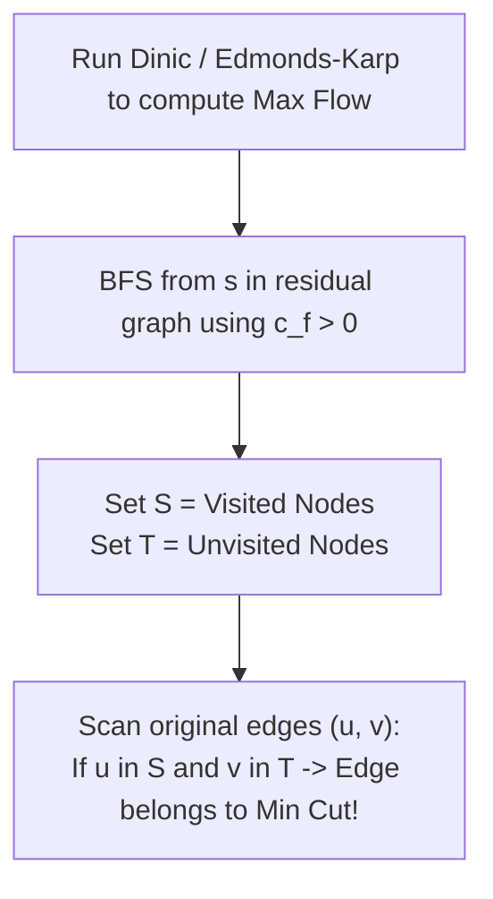
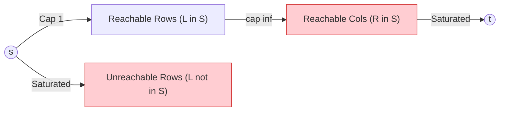

# Week 09 — MaxFlow-MinCut Duality, Police Chase & König's Vertex Cover

> **Official NPTEL Lectures**:
> - Lecture 48 (`0OBcKrQhZuQ`): MaxFlow-MinCut Duality — Cut Capacity, Weak vs Strong Duality & Reachable Sets
> - Lecture 49 (`BPxRdMZaiSA`): Police Chase (CSES 1695) — Edge-Disjoint Paths, Unit Networks & Cut Recovery
> - Lecture 50 (`T52VmijpK5o`): Minimum Vertex Cover via Max Flow | SAM I AM (UVA 11419) — König's Theorem & Bipartite Vertex Reconstruction

---

## 1. The Core Mental Model: Duality & The Network Bottleneck

Consider a network of roads or communications where you wish to sever all connectivity between a source $s$ and a target $t$ with minimal destruction.
- A **Cut $(S, T)$** is a partition of vertices $V$ into two disjoint sets such that:
  $$s \in S \quad \text{and} \quad t \in T$$
- The **Capacity of the Cut $C(S, T)$** is the total capacity of all directed edges originating in $S$ and entering $T$:
  $$C(S, T) = \sum_{u \in S, v \in T, (u, v) \in E} c(u, v)$$

```mermaid
flowchart LR
    subgraph S ["Set S (Contains Source s)"]
        s(("s"))
        u["Node u"]
    end
    subgraph T ["Set T (Contains Sink t)"]
        v["Node v"]
        t(("t"))
    end
    u -->|Counted in Cut: c(u, v)| v
    v -. "Ignored in Cut: (T -> S)" .-> s
```

> [!WARNING]
> **The Directionality Trap (Classic Exam Question)**:
> Only forward edges from $S \to T$ count towards the cut capacity!
> Any backward edge from $T \to S$ has capacity **0** with respect to the cut $(S, T)$ and is completely ignored in the summation.

### Weak vs Strong Duality Theorems
1. **Weak Duality**: For *any* feasible flow $f$ and *any* valid $(s, t)$-cut $(S, T)$:
   $$|f| \le C(S, T)$$
   *(Intuition: You cannot push more water through a pipe network than the capacity of any cross-section cutting source from sink).*
2. **Strong Duality (Ford-Fulkerson MaxFlow-MinCut Theorem)**:
   The maximum flow achievable is **strictly equal** to the minimum cut capacity:
   $$\max |f| = \min_{(S, T)} C(S, T)$$

---

## 2. How to Recover the Minimum Cut in $O(V + E)$

Once max flow has been computed and no augmenting path exists from $s$ to $t$:
1. Look at the **final residual graph $G_f$**.
2. Run a BFS or DFS starting at source $s$, following only edges with **remaining residual capacity $> 0$** ($c_f(u, v) > 0$).
3. Partition the vertices:
   - $S = \{\text{all vertices reachable from } s \text{ in } G_f\}$.
   - $T = V \setminus S$.
4. **The Min-Cut Edges**: All edges $(u, v)$ in the **original graph** such that:
   $$u \in S \quad \text{and} \quad v \in T$$
5. Every such edge must be **fully saturated** ($f(u, v) = c(u, v)$), and their sum of original capacities equals the maximum flow value!



---

## 3. Topic 2: Police Chase (CSES 1695)

### Problem Statement
In a city with $N$ intersections and $M$ bidirectional streets, robbers are trying to escape from intersection $1$ to intersection $N$.
Police want to barricade the **minimum number of streets** to make it impossible to travel from $1$ to $N$.
Print the minimum number of streets, followed by the exact list of streets to close.

### Socratic Modeling
1. Each street has capacity 1 (destroying 1 street costs 1 unit).
2. Undirected edge between $u$ and $v$ is modeled as two directed edges: $u \to v$ (cap 1) and $v \to u$ (cap 1).
3. Compute Max Flow from $s = 1$ to $t = N$ using Dinic's Algorithm.
4. By MaxFlow-MinCut Duality, the minimum number of streets to close equals `maxFlow(1, N)`.
5. Run BFS from node 1 in the residual graph to find the reachable set $S$.
6. For each original street $(u, v)$, if $u \in S$ and $v \in T$ (or vice-versa), output that street!

### Production C++ Implementation
```cpp
#include <iostream>
#include <vector>
#include <queue>

using namespace std;

struct Dinic {
    struct Edge { int to; long long cap, flow; int rev; int id; };
    int n;
    vector<vector<Edge>> adj;
    vector<int> level, ptr;

    Dinic(int n) : n(n), adj(n), level(n), ptr(n) {}

    void addUndirectedEdge(int u, int v, int id) {
        adj[u].push_back({v, 1, 0, (int)adj[v].size(), id});
        adj[v].push_back({u, 1, 0, (int)adj[u].size() - 1, id});
    }

    bool bfs(int s, int t) {
        fill(level.begin(), level.end(), -1);
        level[s] = 0;
        queue<int> q; q.push(s);
        while (!q.empty()) {
            int v = q.front(); q.pop();
            for (const auto& edge : adj[v]) {
                if (edge.cap - edge.flow > 0 && level[edge.to] == -1) {
                    level[edge.to] = level[v] + 1;
                    q.push(edge.to);
                }
            }
        }
        return level[t] != -1;
    }

    long long dfs(int v, int t, long long pushed) {
        if (pushed == 0 || v == t) return pushed;
        for (int& cid = ptr[v]; cid < (int)adj[v].size(); ++cid) {
            auto& edge = adj[v][cid];
            int tr = edge.to;
            if (level[v] + 1 != level[tr] || edge.cap - edge.flow == 0) continue;
            long long tr_pushed = dfs(tr, t, min(pushed, edge.cap - edge.flow));
            if (tr_pushed == 0) continue;
            edge.flow += tr_pushed;
            adj[tr][edge.rev].flow -= tr_pushed;
            return tr_pushed;
        }
        return 0;
    }

    long long maxFlow(int s, int t) {
        long long flow = 0;
        while (bfs(s, t)) {
            fill(ptr.begin(), ptr.end(), 0);
            while (long long pushed = dfs(s, t, 1e18)) flow += pushed;
        }
        return flow;
    }
};

int main() {
    ios::sync_with_stdio(false);
    cin.tie(nullptr);

    int n, m;
    if (!(cin >> n >> m)) return 0;

    Dinic dinic(n + 1);
    vector<pair<int, int>> originalEdges(m);

    for (int i = 0; i < m; ++i) {
        int u, v; cin >> u >> v;
        originalEdges[i] = {u, v};
        dinic.addUndirectedEdge(u, v, i);
    }

    long long minCutCost = dinic.maxFlow(1, n);
    cout << minCutCost << "\n";

    // BFS on residual graph to find reachable set S
    vector<bool> visited(n + 1, false);
    queue<int> q;
    q.push(1);
    visited[1] = true;

    while (!q.empty()) {
        int u = q.front(); q.pop();
        for (const auto& edge : dinic.adj[u]) {
            if (edge.cap - edge.flow > 0 && !visited[edge.to]) {
                visited[edge.to] = true;
                q.push(edge.to);
            }
        }
    }

    // Edges with one endpoint in S and other in T belong to min cut
    for (const auto& [u, v] : originalEdges) {
        if (visited[u] != visited[v]) {
            cout << u << " " << v << "\n";
        }
    }

    return 0;
}
```

---

## 4. Topic 3: König's Theorem & Minimum Vertex Cover (SAM I AM - UVA 11419)

### Problem Statement
An $R \times C$ grid contains enemies. You have a special cannon that can shoot across an entire row or an entire column, destroying all enemies along that line.
Find the **minimum number of shots** to eliminate all enemies, and list the exact rows and columns to shoot.

### The Fundamental Duality: König's Theorem
A **Vertex Cover** of a graph is a set of vertices $S \subseteq V$ such that every edge has at least one endpoint in $S$.
In general graphs, finding the Minimum Vertex Cover is **NP-Hard**.
However, in **Bipartite Graphs**:
$$\mathbf{|\text{Minimum Vertex Cover}| = |\text{Maximum Bipartite Matching}|}$$

### How to Reconstruct the Vertex Cover from the Flow Residual Graph
1. Build the Bipartite Matching flow network:
   - Source $s \to \text{Row}_i$ with capacity 1.
   - For every enemy at $(r, c)$, add directed edge $\text{Row}_r \to \text{Col}_c$ with capacity $\infty$ (or 1).
   - $\text{Col}_c \to \text{Sink } t$ with capacity 1.
2. Run Max Flow.
3. In the final residual graph, run BFS from $s$ to find the reachable set $S$.
4. **The Vertex Cover Extraction Rule**:
   - For the Left side (Rows): pick rows that are **NOT reachable** from $s$ ($L \setminus S$).
   - For the Right side (Cols): pick columns that **ARE reachable** from $s$ ($R \cap S$).



> [!NOTE]
> **Why this works**:
> If an edge $(u, v)$ with $u \in L$ and $v \in R$ exists:
> - If $u \in S$ (reachable), then since edge $(u, v)$ has capacity $\infty$, $v$ must also be reachable ($v \in S$). Thus, column $v$ is chosen!
> - If $u \notin S$, then row $u$ is chosen!
> Therefore, every edge has at least one endpoint chosen, forming a valid vertex cover of size exactly equal to the min-cut!

---

## 5. NPTEL Exam Practice: Hand-Tracing & MCQ Drills

### Exam Problem 1 (NAT): Manual Cut Capacity Calculation
**Question**: Consider a network with vertices $\{s, A, B, t\}$.
Edges and capacities:
$s \to A$ (cap 10), $s \to B$ (cap 5)
$A \to B$ (cap 4), $A \to t$ (cap 8)
$B \to t$ (cap 7)
What is the capacity of the cut $S = \{s, A\}$ and $T = \{B, t\}$?
- **Analysis**:
  - We must sum capacities of all directed edges starting in $S$ and ending in $T$:
    1. Edge $(s, B)$: $s \in S, B \in T \implies$ Capacity = **5**.
    2. Edge $(A, B)$: $A \in S, B \in T \implies$ Capacity = **4**.
    3. Edge $(A, t)$: $A \in S, t \in T \implies$ Capacity = **8**.
    4. Edge $(s, A)$: both in $S \implies$ ignored.
    5. Edge $(B, t)$: both in $T \implies$ ignored.
  - Total Cut Capacity $C(S, T) = 5 + 4 + 8 = \mathbf{17}$.
- **Answer**: **17**.

### Exam Problem 2 (MSQ): Min-Cut Properties
**Question**: Which of the following statements about MaxFlow-MinCut are TRUE?
- (A) In any flow network, the minimum cut is always unique.
- (B) For any valid flow $f$ and any cut $(S, T)$, $|f| \le C(S, T)$.
- (C) All edges crossing the minimum cut in the forward direction must be saturated at maximum flow.
- (D) König's theorem states that Maximum Matching equals Minimum Vertex Cover for all graphs.
- **Answer**: **(B) and (C)**.
  - *(A) is FALSE: graphs can have multiple cuts of identical minimum capacity.*
  - *(B) is TRUE: Weak Duality theorem.*
  - *(C) is TRUE: if a forward cut edge were not saturated, residual capacity would exist, allowing reachability.*
  - *(D) is FALSE: König's theorem holds ONLY for Bipartite graphs.*

---

## 6. Active Retrieval Checkpoint (No-AI Test)

1. *In computing cut capacity $C(S, T)$, why are edges directed from $T$ to $S$ given weight 0?*
2. *Describe the exact 3-step algorithm to recover the edges of a minimum cut from the residual graph.*
3. *State König's Theorem and write the rule for recovering the bipartite vertex cover from the residual reachable set.*
