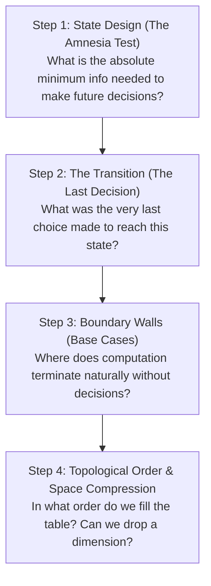
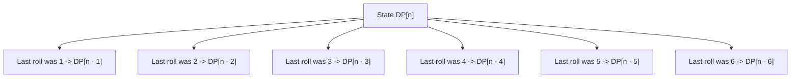

# Week 10 — Dynamic Programming Foundations: DAGs, Recurrences & State Design

> **Official NPTEL Lectures**:
> - Lecture 51 & 52 (`sUhTqfbb84s`, `xEB8ryblINI`): Dynamic Programming Foundations — Memoization, Subproblem DAGs & Frog 1 (AtCoder)
> - Lecture 53 (`0jsO9mDVZbI`): Bottom-Up Tabulation — Dice Combinations (CSES 1633), Modulo Arithmetic & Transitions

---

## 1. The Core Mental Model: DP as Shortest Path on a State DAG

Many students struggle with Dynamic Programming because they try to memorize nested loops. 
Here is the first-principles secret:

> [!IMPORTANT]
> **The Golden Insight**:
> Every Dynamic Programming problem is nothing more than finding the **Shortest, Longest, or Number of Paths on a Directed Acyclic Graph (DAG)** of states!
> - **Vertex in the DAG** = A unique State (a configuration of the problem).
> - **Directed Edge** = A valid transition (a decision you can make).
> - **Weight of Edge** = The cost or benefit of making that decision.
> - **Acyclic Property** = You cannot travel back in time. Decisions progress monotonically towards the goal.

```mermaid
flowchart LR
    S1["Stone 1 (Cost 0)"] -->|cost |h1-h2|| S2["Stone 2"]
    S1 -->|cost |h1-h3|| S3["Stone 3"]
    S2 -->|cost |h2-h3|| S3
    S2 -->|cost |h2-h4|| S4["Stone 4"]
    S3 -->|cost |h3-h4|| S4
```

---

## 2. The 4-Step Socratic Protocol to Find ANY Recurrence

Whenever you face a hard, unseen DP problem on an exam or contest, execute these 4 steps in order:



### Step 1: The "Amnesia Test" for State Design
Ask yourself: *If I am standing at the current point in time, what history do I actually need to remember?*
- Do I need to know *which exact path* took me here? **No!**
- Do I only care about:
  - My current index $i$?
  - My remaining capacity/budget $w$?
  - The color of the last item picked $c$?
- **The Markov Property**: Future decisions must depend *only* on the current state, not on the path taken to arrive at that state.

### Step 2: The Transition (Look at the LAST Decision)
Instead of asking *"Where can I go from here?"* (which leads to confusing forward logic), ask:
**"To arrive at state $S$, what was the very last decision I could have made?"**
- Look backwards one step.
- Partition all ways to enter state $S$ into mutually exclusive choices.

---

## 3. Topic 1: Frog 1 (AtCoder Educational DP Contest)

### Problem Statement
There are $N$ stones numbered $1, 2, \dots, N$. Stone $i$ has height $h_i$.
A frog starts on stone $1$. If the frog is on stone $i$, it can jump to:
- Stone $i + 1$, incurring energy cost $|h_i - h_{i+1}|$.
- Stone $i + 2$, incurring energy cost $|h_i - h_{i+2}|$.
Find the **minimum total energy cost** to reach stone $N$.

### Socratic Derivation
1. **State Definition**:
   Let $DP[i] = \text{Minimum cost to reach stone } i \text{ from stone } 1$.
2. **The Last Decision**:
   To land on stone $i$, the frog made one of two possible jumps:
   - Jumped from stone $i - 1$ (cost $= DP[i-1] + |h_i - h_{i-1}|$).
   - Jumped from stone $i - 2$ (cost $= DP[i-2] + |h_i - h_{i-2}|$).
3. **The Recurrence**:
   $$DP[i] = \min(DP[i-1] + |h_i - h_{i-1}|, \; DP[i-2] + |h_i - h_{i-2}|)$$
4. **Base Cases**:
   - $DP[1] = 0$ (starting stone costs 0 energy).
   - $DP[2] = |h_2 - h_1|$ (only 1 jump possible).
5. **Topological Order**:
   Iterate $i = 3, 4, \dots, N$.
   Notice $DP[i]$ only requires $DP[i-1]$ and $DP[i-2] \implies \mathbf{O(1)}$ space!

### Production C++ Implementation (Space-Optimized $O(N)$ Time, $O(1)$ Space)
```cpp
#include <iostream>
#include <vector>
#include <cmath>
#include <algorithm>

using namespace std;

int main() {
    ios::sync_with_stdio(false);
    cin.tie(nullptr);

    int n;
    if (!(cin >> n)) return 0;

    vector<int> h(n + 1);
    for (int i = 1; i <= n; ++i) cin >> h[i];

    if (n == 1) { cout << 0 << "\n"; return 0; }

    int prev2 = 0;                  // DP[1]
    int prev1 = abs(h[2] - h[1]);   // DP[2]

    for (int i = 3; i <= n; ++i) {
        int current = min(prev1 + abs(h[i] - h[i - 1]),
                          prev2 + abs(h[i] - h[i - 2]));
        prev2 = prev1;
        prev1 = current;
    }

    cout << prev1 << "\n";
    return 0;
}
```

---

## 4. Topic 2: Dice Combinations (CSES 1633) — Counting Transitions

### Problem Statement
Count the number of distinct ways to construct a sum $N$ by throwing a standard 6-sided dice one or more times.
Each throw produces an integer in $\{1, 2, 3, 4, 5, 6\}$.
Because the answer can be large, output it modulo $10^9 + 7$.

### Socratic Derivation: Partitioning by the Last Roll
1. **State Definition**:
   Let $DP[n] = \text{Total number of ordered throw sequences summing to } n$.
2. **The Last Decision**:
   What was the very last roll on the dice that brought the sum to $n$?
   The last roll could have been:
   - Roll was 1: previous sum must have been $n - 1$ ($DP[n-1]$ ways).
   - Roll was 2: previous sum must have been $n - 2$ ($DP[n-2]$ ways).
   - Roll was 3: previous sum must have been $n - 3$ ($DP[n-3]$ ways).
   - Roll was 4: previous sum must have been $n - 4$ ($DP[n-4]$ ways).
   - Roll was 5: previous sum must have been $n - 5$ ($DP[n-5]$ ways).
   - Roll was 6: previous sum must have been $n - 6$ ($DP[n-6]$ ways).
3. **The Recurrence**:
   $$DP[n] = \sum_{k=1}^6 DP[n - k] \pmod{10^9 + 7}$$
4. **Base Case (The Neutral State)**:
   $DP[0] = 1$ (there is exactly 1 way to form sum 0: make 0 throws).
   For any $k < 0$, $DP[k] = 0$.



### Production C++ Implementation
```cpp
#include <iostream>
#include <vector>

using namespace std;

const int MOD = 1e9 + 7;

int main() {
    ios::sync_with_stdio(false);
    cin.tie(nullptr);

    int n;
    if (!(cin >> n)) return 0;

    vector<int> dp(n + 1, 0);
    dp[0] = 1; // Base case: 1 way to get sum 0 (empty sequence)

    for (int i = 1; i <= n; ++i) {
        for (int dice = 1; dice <= 6; ++dice) {
            if (i - dice >= 0) {
                dp[i] = (dp[i] + dp[i - dice]) % MOD;
            }
        }
    }

    cout << dp[n] << "\n";
    return 0;
}
```

---

## 5. Master Taxonomy: The 4 Classic CP DP Families

| DP Family | State Template | Recurrence Pattern | Typical Complexity | Example Problem |
| :--- | :--- | :--- | :--- | :--- |
| **Linear 1D** | $DP[i]$ | Transitions from $i - 1, i - 2, \dots$ | $O(N)$ | Frog 1, House Robber |
| **Knapsack / 2D** | $DP[i][w]$ | Include vs Exclude item $i$ with weight $w$ | $O(N \cdot W)$ | 0-1 Knapsack, Coin Change |
| **Interval DP** | $DP[l][r]$ | Split range $[l, r]$ at midpoint $k \in [l, r-1]$ | $O(N^3)$ | Matrix Chain Multiplication |
| **Counting / Combinations**| $DP[n]$ | Sum of subproblem transitions mod $M$ | $O(N \cdot K)$ | Dice Combinations |

---

## 6. NPTEL Exam Practice: Hand-Tracing & MCQ Drills

### Exam Problem 1 (NAT): Manual DP Table Calculation (Dice Combinations)
**Question**: Using the recurrence for Dice Combinations, calculate the exact value of $DP[4]$.
- **Hand Trace**:
  - $DP[0] = 1$
  - $DP[1] = DP[0] = \mathbf{1}$
  - $DP[2] = DP[1] + DP[0] = 1 + 1 = \mathbf{2}$
  - $DP[3] = DP[2] + DP[1] + DP[0] = 2 + 1 + 1 = \mathbf{4}$
  - $DP[4] = DP[3] + DP[2] + DP[1] + DP[0] = 4 + 2 + 1 + 1 = \mathbf{8}$
- **Verification**: The 8 sequences for sum 4 are:
  - $(4)$
  - $(3, 1), (1, 3)$
  - $(2, 2)$
  - $(2, 1, 1), (1, 2, 1), (1, 1, 2)$
  - $(1, 1, 1, 1)$
- **Answer**: **8**.

### Exam Problem 2 (MSQ): Dynamic Programming Requirements
**Question**: Which of the following conditions are REQUIRED for Dynamic Programming to yield an optimal polynomial-time solution?
- (A) The subproblems must be independent and non-overlapping.
- (B) The problem must exhibit **Optimal Substructure** (optimal solution contains optimal solutions to subproblems).
- (C) The state-space dependencies must form a **Directed Acyclic Graph (DAG)**.
- (D) The state space must be strictly 1-dimensional.
- **Answer**: **(B) and (C)**.
  - *(A) is FALSE: if subproblems are non-overlapping, divide-and-conquer suffices; DP specifically exploits *overlapping* subproblems!*
  - *(B) is TRUE: fundamental Bellman Principle of Optimality.*
  - *(C) is TRUE: cycles in transitions cause infinite recursion / deadlocks.*
  - *(D) is FALSE: DP states can be 2D, 3D, bitmasks, etc.*

---

## 7. Active Retrieval Checkpoint (No-AI Test)

1. *State the 4 steps of the Socratic DP Protocol from memory.*
2. *In Dice Combinations, why is the base case $DP[0] = 1$ rather than $DP[0] = 0$?*
3. *Why can Frog 1 be computed using only 2 variables of memory instead of an array of size $N$?*
